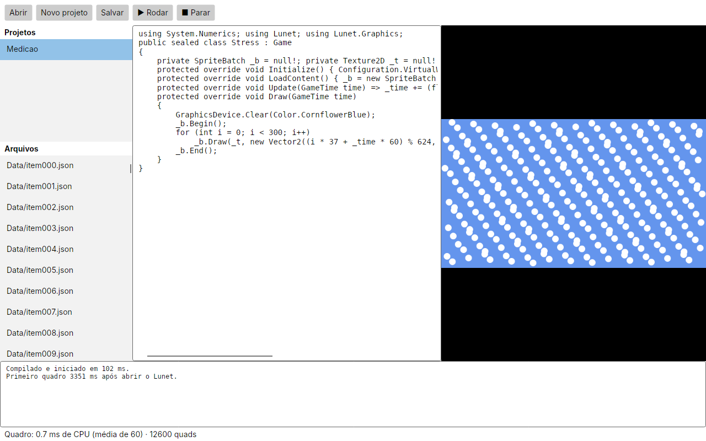

# Spike LUNET-482 — casca Avalonia, desktop primeiro (DEC-0062, alternativa A)

**Data:** 2026-11-14 · **ADR:** [0012](../adr/0012-expansao-multiplataforma.md) (Aceito) · **Estado:** spike executado; números de desktop real e comparação com o Android no mesmo aparelho ainda pendentes (NN-017).

## O que foi construído

- `src/Lunet.Runtime/SoftwareGraphicsBackend.cs`: rasterizador em CPU com a semântica do backend OpenGL ES (eixo Y da janela para cima, render target com a linha 0 embaixo, scissor em pixels da janela, os cinco modos de mistura). Caminho rápido para sprites sem rotação (inteiros, coordenadas incrementais). Shaders customizados não são executados (contados em `IgnoredShaders`). Sem dependência nova de GPU.
- `src/Lunet.Host/WorkspaceSession.cs`: lógica comum a hosts não Android — pasta de projetos, abrir/criar, arquivos, compilar com Roslyn, rodar com o rasterizador, entrada de ponteiro e teclado, tempo de quadro.
- `src/Lunet.Desktop`: casca Avalonia 12.1.3 (Windows/Linux/macOS): projetos, arquivos, editor, Rodar/Parar, prévia do jogo com mouse e teclado, console e números ao vivo. O host Android **não mudou**.
- Modo de medição: `dotnet run -c Release --project src/Lunet.Desktop -- --measure [pasta]` usa a mesma janela renderizada fora da tela (Avalonia headless + Skia) e grava uma captura.

## Números (contêiner Linux, 4 núcleos, .NET 10.0.15, Release, sem GPU)

| Critério do ADR 0012 | Medido |
|---|---|
| Partida a frio (inicialização do Avalonia) | 115–143 ms |
| Janela até o primeiro quadro renderizado | 408–545 ms |
| Compilação do projeto inicial (Roslyn, fria) | 1,2–1,4 s |
| Recompilação (quente) | 25–28 ms |
| Quadro da prévia, 640×360, 0 sprites | 0,16 ms (mediana) |
| Quadro da prévia, 500 sprites 16×16 | 1,1 ms (mediana), 5,8 ms (p95) |
| Quadro da prévia, 2000 sprites 16×16 | 4,0 ms (mediana), 6,7 ms (p95) |
| Rolagem de lista com 402 arquivos | 16–19 ms por passo renderizado (Skia em CPU) |

O caminho rápido do rasterizador reduziu 2000 sprites de 262 ms para 4 ms por quadro (65×). Shaders customizados e rotações caem no caminho genérico (correto, mais lento).

## Leitura

- **Viável:** a mesma lógica de projeto, compilação e jogo roda no desktop sem reescrever Framework, Compiler ou Runtime (NN-005), com folga para 60 quadros por segundo em cenas 2D típicas, mesmo sem GPU.
- **Pendente para fechar o spike:** os mesmos números num Windows/macOS/Linux com tela real (o `--measure` roda em qualquer um), a latência de toque/caneta numa tela sensível ao toque e a comparação com o Android nativo no mesmo aparelho (Avalonia também roda no Android). Sem isso, nenhuma plataforma é marcada como suportada.
- **Próximo passo (LUNET-493):** Studios e IA no desktop reaproveitando os núcleos portáteis (`Lunet.Studio`, `Lunet.Ai`), backend GL opcional quando a prévia precisar de shaders, e empacotamento por sistema.
