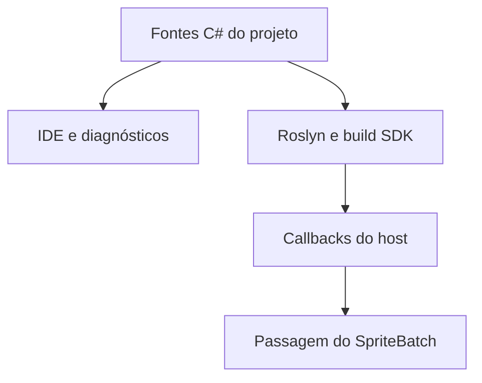

# Lunet Framework — Consolidação arquitetural das três propostas

**Base auditada:** [Ecosystem, `main` em `952659e8e7f08a3a8ebdd8d60186697aef6c7b5a`](https://github.com/AbnerCruz/Ecosystem/commit/952659e8e7f08a3a8ebdd8d60186697aef6c7b5a), integração da F4 no [PR #1028](https://github.com/AbnerCruz/Ecosystem/pull/1028). **Data:** 24/11/2026. **Natureza:** recomendações de estudo para apreciação do proprietário. Nenhuma API, implementação, configuração de projeto ou versão do Lunet é alterada por este documento.

| Estudo independente | Pergunta que ele responde |
| --- | --- |
| [Importações globais](Lunet-estudo-importacoes-globais.md) | Quais símbolos os jogos realmente usam e qual representação oferece o mesmo C# nos diferentes caminhos de compilação? |
| [Dependências contextuais](Lunet-estudo-dependencias-contextuais.md) | Que dependências têm identidade inequívoca durante um callback e como preservar isolamento, propriedade e extensibilidade? |
| [Ordenação de renderização](Lunet-estudo-ordenacao-renderizacao.md) | O que deve ser ordenado, quando a ordem se torna irreversível e quais garantias cabem à fila de desenho e à cena? |

## Julgamento

| Proposta | Classificação | Julgamento técnico |
| --- | --- | --- |
| Ordenação 2D explícita por chave | **Recomendada com alterações**, prioridade funcional mais alta | Empates em ordem de submissão, escopo delimitado pela passagem e compatibilidade com a ordem e os pontos de envio existentes quando a opção estiver desligada. Uma fila em nível de cena cobre âncoras e grupos. |
| Importações globais de C# em fonte visível | **Recomendada com alterações** | Usar diretivas convencionais num arquivo de configuração do projeto que o Explorer apresenta agrupado e abre como fonte. O perfil com os 26 nomes exatos é tecnicamente inviável no snapshot. Corrigir inventário, validar o perfil oferecido e evitar migração automática. |
| Fachada contextual plana opcional | **Experimental** | Comparar a ergonomia com composição explícita antes de aumentar a API pública. Resolução por callback de host, com garantias separadas de vida útil e afinidade gráfica. |
| SpriteBatch contextual | **Adiada** | Só reavaliar depois de estabilizar o contrato de passagem e demonstrar ganho de ergonomia sobre a passagem de um único argumento. Um lote permanente por jogo seria incompatível com múltiplas passagens. |
| Singleton mutável de recursos e hierarquia obrigatória de contextos | **Rejeitada** | A primeira solução quebra isolamento. A segunda introduz dependências e tipos sem demonstrar ganho em cada escopo. |
| Container próprio de DI e reexportação de tipos .NET sob `Lunet` | **Desnecessária** | Registro tipado e composição já resolvem parte dos casos de customização. C# já oferece importação e alias, preservando a identidade dos tipos .NET. |

### Onde o código muda o diagnóstico

- **A paridade de imports é responsabilidade dos consumidores das fontes.** `LunetProject.ListFiles/LoadSources/ExportZip` controla a entrada dos caminhos dinâmicos e do ZIP. `CodeAnalyzer.NewCompilation` e `GameCompiler.CompileIncremental` criam compilações Roslyn separadas. O build SDK usa o glob de `Lunet.GameCode.csproj` e herda propriedades MSBuild que também afetam importações. O caminho `.lunet/` é reservado e excluído. Uma projeção do Explorer resolve a apresentação sem criar uma segunda autoridade de compilação. [LunetProject](https://github.com/AbnerCruz/Ecosystem/blob/952659e8e7f08a3a8ebdd8d60186697aef6c7b5a/apps/lunet2d/src/Lunet.Core/LunetProject.cs#L8-L39) · [GameCompiler](https://github.com/AbnerCruz/Ecosystem/blob/952659e8e7f08a3a8ebdd8d60186697aef6c7b5a/apps/lunet2d/src/Lunet.Compiler/GameCompiler.cs#L20-L85) · [CodeAnalyzer](https://github.com/AbnerCruz/Ecosystem/blob/952659e8e7f08a3a8ebdd8d60186697aef6c7b5a/apps/lunet2d/src/Lunet.Editor/CodeAnalyzer.cs#L29-L58) · [GameCode](https://github.com/AbnerCruz/Ecosystem/blob/952659e8e7f08a3a8ebdd8d60186697aef6c7b5a/apps/lunet2d/runtime-template/Lunet.GameCode.csproj#L1-L15)
- **Assembly disponível é uma condição anterior à diretiva.** O provedor carrega referências opcionais e usa metadados dos assemblies carregados. A exportação SDK tem seu próprio conjunto de referências. Pastas chamadas `Inspection` e funcionalidades de multiplayer jamais comprovam nomes de namespace. A lista do proprietário é um inventário a confrontar com símbolos públicos acessíveis. [LoadedAssembliesReferenceProvider](https://github.com/AbnerCruz/Ecosystem/blob/952659e8e7f08a3a8ebdd8d60186697aef6c7b5a/apps/lunet2d/src/Lunet.Compiler/LoadedAssembliesReferenceProvider.cs#L12-L59) · [GameCode](https://github.com/AbnerCruz/Ecosystem/blob/952659e8e7f08a3a8ebdd8d60186697aef6c7b5a/apps/lunet2d/runtime-template/Lunet.GameCode.csproj#L9-L14)
- **Um jogo ativo tem serviços com proprietários diferentes.** `Game` expõe instâncias por jogo, `GameHost` compõe dispositivo, conteúdo e entrada, `GameServices` só guarda entradas por tipo. Substituir uma entrada em `GameServices` não redireciona campos privados já anexados pelo host. O carregador dinâmico cria o ponto de entrada com `Activator.CreateInstance`; construtores explícitos continuam úteis em classes de jogo criadas pelo próprio ponto de entrada. [Game](https://github.com/AbnerCruz/Ecosystem/blob/952659e8e7f08a3a8ebdd8d60186697aef6c7b5a/apps/lunet2d/src/Lunet.Framework/Game.cs#L30-L131) · [GameHost](https://github.com/AbnerCruz/Ecosystem/blob/952659e8e7f08a3a8ebdd8d60186697aef6c7b5a/apps/lunet2d/src/Lunet.Framework/GameHost.cs#L97-L123) · [GameServices](https://github.com/AbnerCruz/Ecosystem/blob/952659e8e7f08a3a8ebdd8d60186697aef6c7b5a/apps/lunet2d/src/Lunet.Framework/Utilities/GameServices.cs#L11-L40) · [GameLoader](https://github.com/AbnerCruz/Ecosystem/blob/952659e8e7f08a3a8ebdd8d60186697aef6c7b5a/apps/lunet2d/src/Lunet.Runtime/GameLoader.cs#L28-L64)
- **Callback ativo e thread autorizada são condições independentes.** `HeadlessGameRunner.RunAsync` pode continuar em outra thread entre ticks. Preview e standalone têm caminhos diferentes de encerramento, incluindo chamada direta em `StandaloneGameActivity.OnDestroy` e enfileiramento na GL em `PreviewHost.Shutdown`. A fachada não corrigiria esse ciclo de vida por associação de contexto. [HeadlessGameRunner](https://github.com/AbnerCruz/Ecosystem/blob/952659e8e7f08a3a8ebdd8d60186697aef6c7b5a/apps/lunet2d/src/Lunet.Runtime/HeadlessGameRunner.cs#L45-L68) · [StandaloneGameActivity](https://github.com/AbnerCruz/Ecosystem/blob/952659e8e7f08a3a8ebdd8d60186697aef6c7b5a/apps/lunet2d/runtime-template/StandaloneGameActivity.cs#L89-L110) · [PreviewHost](https://github.com/AbnerCruz/Ecosystem/blob/952659e8e7f08a3a8ebdd8d60186697aef6c7b5a/apps/lunet2d/src/Lunet.Android/PreviewHost.cs#L172-L201)
- **A ordem atual já atravessa envios físicos.** Textura diferente e capacidade esgotada fazem `Flush` em `Draw`; `End` envia o restante. No momento do envio são lidos projeção e uniforms. Acrescentar profundidade aos quads restantes não alcança o que já foi desenhado. Adiar o modo padrão mudaria o instante em que ele observa o estado. [SpriteBatch](https://github.com/AbnerCruz/Ecosystem/blob/952659e8e7f08a3a8ebdd8d60186697aef6c7b5a/apps/lunet2d/src/Lunet.Framework/Graphics/SpriteBatch.cs#L122-L164) · [Flush/End](https://github.com/AbnerCruz/Ecosystem/blob/952659e8e7f08a3a8ebdd8d60186697aef6c7b5a/apps/lunet2d/src/Lunet.Framework/Graphics/SpriteBatch.cs#L225-L240) · [GraphicsDevice](https://github.com/AbnerCruz/Ecosystem/blob/952659e8e7f08a3a8ebdd8d60186697aef6c7b5a/apps/lunet2d/src/Lunet.Framework/Graphics/GraphicsDevice.cs#L166-L205)
- **O contraste com o MonoGame importa aqui.** Os modos de profundidade documentam empates instáveis. O `Deferred` documenta envio em `End`. Usar os mesmos nomes para uma semântica diferente criaria expectativa errada em quem migra de XNA ou MonoGame. Adicionar um parâmetro opcional substituindo a assinatura quebra binários já compilados, e sobrecargas novas precisam de teste de resolução em chamadas com `null`, `default` e argumentos nomeados. [MonoGame SpriteSortMode](https://docs.monogame.net/api/Microsoft.Xna.Framework.Graphics.SpriteSortMode.html) · [Compatibilidade de bibliotecas .NET](https://learn.microsoft.com/dotnet/standard/library-guidance/breaking-changes)

## Relações e limites

| Relação | Implicação |
| --- | --- |
| Imports × fachada | `using static` altera o conjunto de candidatos de nomes. A fachada vincula instâncias em execução. Pode-se experimentar uma fachada qualificada em alguns scripts, sem fazer dela dependência dos imports e sem importá-la por padrão. |
| Fachada × ordenação | Um acesso implícito ao lote esconderia qual câmera, target, shader e ordem estão ativos. Manter o lote explícito conserva o ponto onde a passagem é escolhida. Para um lote contextual futuro, a conclusão sobre a passagem já precisa estar estabilizada. |
| Imports × ordenação | Apenas coexistência no código do jogo. Nem a API gráfica nem a capacidade de compilar uma fila precisam de importações automáticas. O build de regressão pode cobrir ambas juntas depois de validá-las em separado. |
| Framework × IDE × Studio | A organização da árvore pertence à IDE e não entra no Framework. A resolução contextual e os limites de passagem pertencem à execução. Studio pode gerar ou editar fontes inspecionáveis, preservando arquivos que o usuário escreveu. [ADR 0007](https://github.com/AbnerCruz/Ecosystem/blob/952659e8e7f08a3a8ebdd8d60186697aef6c7b5a/apps/lunet2d/docs/adr/0007-framework-ide-studio-code-first.md) |
| Infraestrutura comum | Reaproveitar a jornada e fixtures de jogo como validação. Um contêiner, um conjunto de contextos, um grafo de renderização ou um manifesto comum exigiriam benefícios próprios e evidência de consumidores. |

### Consequências para um jogo top-down

A posição dos pés decide a relação entre árvore e personagem. Uma parede comprida, telhado ou entidade com sombra e corpo pode precisar de múltiplas partes e de uma política de grupo acima do lote. Câmeras e destinos de renderização independentes constituem passagens independentes. Um exemplo simples pode ordenar dois objetos pela projeção de suas âncoras e chamar o `SpriteBatch` existente. O benefício da capacidade nativa surge quando vários produtores dentro de uma mesma passagem precisam entregar profundidades sem conhecer previamente os demais comandos.

O contraexemplo de transparência foi executado com `SoftwareGraphicsBackend` do próprio Lunet em .NET SDK 10.0.100 no Linux. Três sprites coincidentes sobre preto, na ordem vermelho–azul–vermelho, produziram RGBA `160,0,64,255`. Agrupar vermelho–vermelho–azul produziu `96,0,128,255`. Texturas sólidas 4×4, alfa 128, multiplicador branco, amostra em (1,1). Isso isola a diferença de composição no backend CPU, sem medir tempo e sem validar EGL/GLES no Android. O headless de servidor contabiliza quads e chamadas de desenho e ignora pixels. O estudo de renderização também reproduziu que um sprite pendente pode ser enviado com os uniforms e o alvo vigentes no flush, diferentes dos usados na submissão. As equações de alfa de alguns modos divergem entre GLES e rasterização CPU em destinos transparentes. [SoftwareGraphicsBackend](https://github.com/AbnerCruz/Ecosystem/blob/952659e8e7f08a3a8ebdd8d60186697aef6c7b5a/apps/lunet2d/src/Lunet.Runtime/SoftwareGraphicsBackend.cs) · [HeadlessGraphicsBackend](https://github.com/AbnerCruz/Ecosystem/blob/952659e8e7f08a3a8ebdd8d60186697aef6c7b5a/apps/lunet2d/src/Lunet.Framework/Graphics/HeadlessGraphicsBackend.cs) · [Khronos, Transparency Sorting](https://wikis.khronos.org/opengl/Transparency_Sorting)

### Ordem de prioridade e critérios de revisão

1. **Priorizar ordenação** pela ampliação de capacidade. O sinal decisivo é diferença correta por profundidade acima dos limites físicos, com sprites transparentes e intercalados. Estabilidade de empates, falhas durante envio e barreiras de render target/shader precisam ser observáveis. Adiar otimização por textura/material se não houver um domínio em que reordenar preserve a intenção visual.
2. **Validar imports em paralelo**, como melhoria independente. A meta é conseguir abrir, alterar e portar a mesma fonte. Conferir árvore de fontes e símbolos ligados, por host, com e sem SDK implícito. Rejeitar perfil amplo indiscriminado se interferir em projetos antigos ou exigir ambientes de build incompatíveis para resolver os mesmos nomes.
3. **Comparar ergonomia contextual em jogos reais** só para os candidatos de escopo claro. Um exemplo que troca quatro repasses por nove consultas ambientais tem saldo duvidoso. Um experimento deve preservar composição explícita, reportar falha sem contexto e comprovar isolamento em dois hosts, inclusive após exceções.
4. **Revisitar lote contextual apenas como proposta separada** se a combinação de casos reais mostrar benefício que um parâmetro, um objeto criado pelo usuário ou uma fila de cena não consiga entregar. Exigir uma resposta explícita para o que acontece ao sair da passagem com falha.

## Evidência que falta para aprovação de um desenho

| Eixo | Validação pertinente | Critério que derruba a hipótese |
| --- | --- | --- |
| Origem das importações | Round-trip de editar/remover/renomear, Git/ZIP, reabertura, análise da IDE, Preview rápido/isolado, desktop, APK offline e build SDK/cloud. Cobrir arquivo extra em pasta normal e projeto antigo com colisões existentes. | O mesmo arquivo liga nomes a símbolos diferentes por causa de imports, ou o usuário deixa de localizar e editar a origem. |
| Isolamento de execução | Dois hosts numa thread e em threads distintas, reentrada A→B→A, exceção antes/depois de obter serviços, encerramento do Preview, teardown do APK, queue de Dispatcher, headless com continuação em outra thread. | Serviço de outro jogo aparece, recurso sobrevive indevidamente, descarte acontece em thread incompatível ou a fachada impede execução headless. |
| Ordem e composição | Backend espião para sequência/alvos e CPU para pixels, com comparações visuais posteriores em GLES. Lotes de 2.047/2.048/2.049 quads, texto, atlas, nine-slice, partículas, tilemaps, targets, shaders e duas câmeras. | Ordem global se torna local ao buffer de envio, empates mudam ou o caminho legado altera pixels, erros ou momentos de envio. |
| Custos mobile | Comparar mesma cena e build, separar submissão, ordenação, expansão, uploads, draw calls, alocações/GC e CPU/GPU de cada quadro. Verificar tempo de cauda, pico de memória e primeiro uso, além da mediana. | Custo do modo opcional fica incompatível com o uso real ou degrada sistematicamente o modo padrão sem benefício correspondente. |
| Compatibilidade pública | Fixture de assemblies compilados com a API atual e recompilação dos exemplos, inspecionando assinaturas, binding e divergências de comportamento. | Um `Draw`/ `Begin` já compilado deixa de resolver ou uma chamada explícita do corpus fica ambígua. |

Já existem testes de fronteira, portabilidade e jornada que servem de ponto de partida. A presença deles no snapshot demonstra cobertura escrita; as propostas exigem novos oráculos específicos. A relação com itens históricos é de rastreabilidade: LUNET-302 para fronteiras code-first, LUNET-450/451 para a jornada e corpus, LUNET-482 para o spike desktop. Nenhum desses IDs é atualizado por este estudo. Browser e iOS continuam fora da compatibilidade demonstrada. [ArchitectureTests](https://github.com/AbnerCruz/Ecosystem/blob/952659e8e7f08a3a8ebdd8d60186697aef6c7b5a/apps/lunet2d/tests/Lunet.Tests/ArchitectureTests.cs#L24-L74) · [ProjectJourneyTests](https://github.com/AbnerCruz/Ecosystem/blob/952659e8e7f08a3a8ebdd8d60186697aef6c7b5a/apps/lunet2d/tests/Lunet.Tests/ProjectJourneyTests.cs) · [ADR 0012](https://github.com/AbnerCruz/Ecosystem/blob/952659e8e7f08a3a8ebdd8d60186697aef6c7b5a/apps/lunet2d/docs/adr/0012-expansao-multiplataforma.md)

## Verificação executada na base

| Evidência | Resultado |
| --- | --- |
| Corpus Roslyn 5.9 e referências de .NET 10 | Os 26 nomes foram verificados em dois conjuntos de referências Linux. Os dois namespaces ausentes geraram CS0234. Os casos sintéticos demonstraram colisão de tipos e extensões. |
| `Lunet.GameCode.csproj` e `lunet-server --check` | Um jogo isolado com os 24 nomes válidos numa subpasta compilou pelos dois caminhos locais. Isso não cobre estado de editor, APK ou paridade de bindings em outros jogos. |
| Escopo assíncrono e escopo por thread | O ensaio com execução controlada confirmou propagação lógica fora do callback e captura do escopo físico de B quando uma continuação de A é bombeada na thread de B. |
| Suite Lunet em Debug | Runner direto de xUnit v3, .NET 10, 1.179 testes aprovados, zero falhas e ignorados. |
| Recorte gráfico em Release | 132 de 133. O teste existente de alocação de quadro com toque/gestos falhou neste ambiente, inclusive isoladamente, como detalhado no estudo gráfico. Resultados de Debug e Release são execuções distintas. |

Nenhum ensaio mediu o custo de uma implementação nova ou exercitou Android físico. A classificação de prioridade vem do problema funcional e do comportamento auditado.

## Rastreabilidade dos documentos do proprietário

Os anexos foram lidos integralmente. Os SHA-256 abaixo identificam os originais preservados, incluindo os trechos históricos e recomendações posteriormente reconsideradas.

| Documento fornecido | SHA-256 |
| --- | --- |
| `01-Lunet-importacoes-globais.md` | `baca50da23cbe793a458d6da9f41e1720046500e1e8df031ed8820de8e265d55` |
| `02-Lunet-dependencias-contextuais.md` | `071892729f9b9c175d4afce7972648d560f196d9436d3fdd1bb7b5d854c056ce` |
| `03-Lunet-ordenacao-renderizacao.md` | `4b53d69b219941669a25f57f026930e39fbf7b940528fd66fd464bfe128d12fa` |
