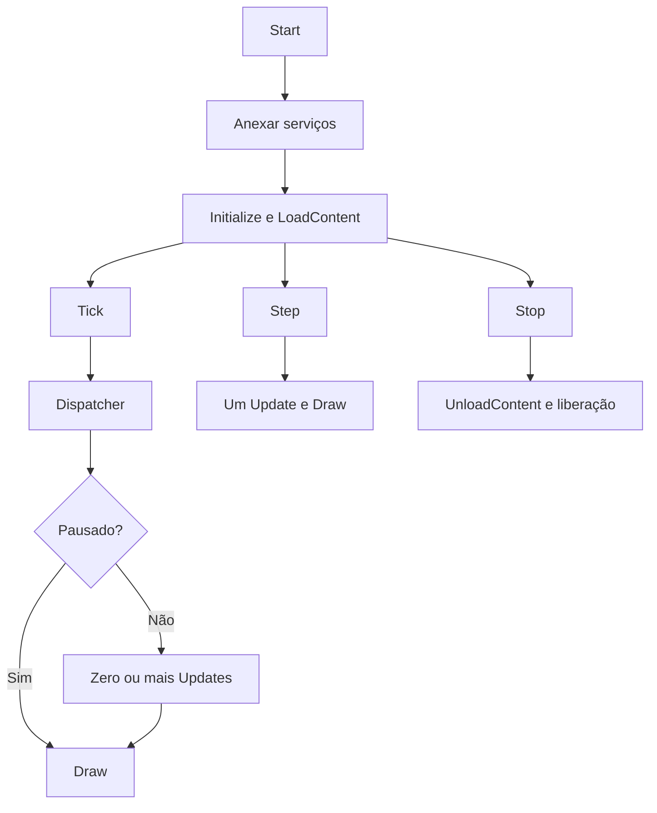
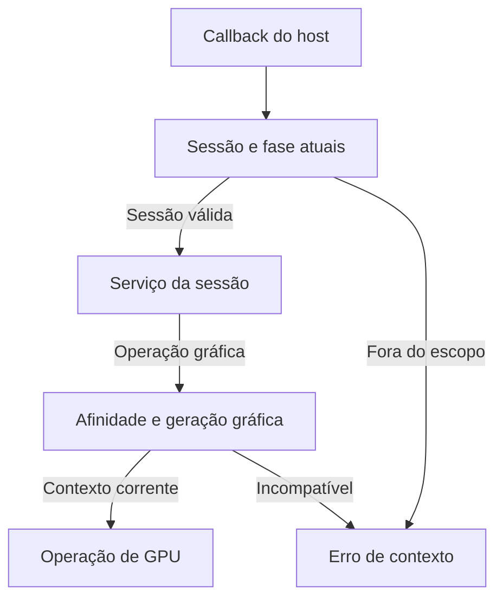

# Lunet Framework — Estudo de dependências contextuais

**Data:** 24 de novembro de 2026 · **Base canônica:** Ecosystem `main` @ `952659e8e7f08a3a8ebdd8d60186697aef6c7b5a` (F4, PR #1028) · **Estado:** estudo para decisão.

Foram examinados os três documentos preliminares, incluindo as sugestões históricas de escopos hierárquicos, `using static`, fábricas sem dispositivo e `UseBatch`, depois reconsideradas no próprio registro. Este estudo distingue leitura estática da árvore canônica, resultados de um experimento isolado, evidência externa e hipóteses para validação posterior. Os originais permanecem como registros da discussão.

**Parecer.** A repetição de dependências é real quando classes recebem referências de que mal precisam. A primeira resposta é compor objetos com os recursos de que efetivamente precisam e passar o lote da passagem ao desenhar. Uma fachada plana, localmente optativa e síncrona, merece experimento de ergonomia. Habilitá-la para todo subsistema de uma vez cria um contrato de execução consideravelmente maior que seu ganho sintático. O lote implícito fica adiado. A ordem de sprites demanda decisão própria e tem prioridade funcional.

## I — Auditoria interna

### A arquitetura que existe

| Componente | Responsabilidade, dependências e ownership verificados |
|---|---|
| `Game` | É a instância que recebe dispositivo, entrada, conteúdo, saves e haptics em `Attach`. Cria o próprio registro, dispatcher, log, timers e configuração. `Audio` e `Localization` são atalhos do `ContentManager`. Propriedades centrais como `GraphicsDevice` e `Content` leem campos privados instalados por `Attach`. O áudio usa o mixer de conteúdo mesmo fora do registro. [Game.cs, linhas 30–70 e 101–131](https://github.com/AbnerCruz/Ecosystem/blob/952659e8e7f08a3a8ebdd8d60186697aef6c7b5a/apps/lunet2d/src/Lunet.Framework/Game.cs#L30-L131). |
| `GameHost` | Recebe `IGraphicsBackend`, `IContentSource`, `IAudioBackend`, `ISaveStore` e `IHaptics`; o chamador pode escolher esses adaptadores na composição do host. Cria dispositivo, conteúdo e save em `Start`; a entrada é construída por instância do host. Cria um loop fixo, dá encaminhamento para `Step`, `Tick`, pausa e retomada, captura falhas e controla parte do descarte. A classe é selada. [GameHost.cs, linhas 20–66 e 93–118](https://github.com/AbnerCruz/Ecosystem/blob/952659e8e7f08a3a8ebdd8d60186697aef6c7b5a/apps/lunet2d/src/Lunet.Framework/GameHost.cs#L20-L118). |
| `GameServices` | Registro por tipo exato, via `Dictionary<Type, object>`. `Add<T>` sobrescreve, `Get<T>` lança na ausência, `TryGet<T>` oferece consulta opcional e `Remove<T>` só remove. O objeto original não é descartado no replace/remove. Não há factory, validação de ciclo, lock, propriedade transitiva nem fechamento do registro. Serve como localizador quando um consumidor consulta a instância por conta própria. [GameServices.cs](https://github.com/AbnerCruz/Ecosystem/blob/952659e8e7f08a3a8ebdd8d60186697aef6c7b5a/apps/lunet2d/src/Lunet.Framework/Utilities/GameServices.cs#L11-L40). |
| `GraphicsDevice`, `IGraphicsBackend` | O dispositivo selado tem projeção, resolução virtual, viewport, alvo de renderização, transformações de coordenadas e textura branca de criação preguiçosa. O backend recebe criação/destruição de recursos, estado gráfico e quads. O contrato disponível ao jogo não tem uma API pública de buffers/triângulos/depth-stencil análoga à do MonoGame. `ReleaseResources` libera a textura branca do dispositivo, uma responsabilidade mais estreita que destruir todos os recursos criados pelo usuário. [GraphicsDevice.cs](https://github.com/AbnerCruz/Ecosystem/blob/952659e8e7f08a3a8ebdd8d60186697aef6c7b5a/apps/lunet2d/src/Lunet.Framework/Graphics/GraphicsDevice.cs#L16-L205), [IGraphicsBackend.cs](https://github.com/AbnerCruz/Ecosystem/blob/952659e8e7f08a3a8ebdd8d60186697aef6c7b5a/apps/lunet2d/src/Lunet.Framework/Graphics/IGraphicsBackend.cs#L15-L73). |
| `ContentManager` | Origem de arquivos, caches por instância e dispositivo para o upload. `LoadTexture` transforma PNG em textura com upload, de modo que o atalho contextual para conteúdo também pode chegar à GPU. `Dispose` libera texturas, fontes, sons e músicas do cache, limpa atlas e para música; o backend injetado fica sob responsabilidade da composição. Não há estado de descarte que torne todas as operações subsequentes impossíveis. [ContentManager.cs, linhas 15–65 e 209–222](https://github.com/AbnerCruz/Ecosystem/blob/952659e8e7f08a3a8ebdd8d60186697aef6c7b5a/apps/lunet2d/src/Lunet.Framework/Content/ContentManager.cs#L15-L222). |
| `AudioMixer` | Um mixer construído pelo conteúdo sobre `IAudioBackend`; áudio nulo gera `NullAudioBackend`. Barramentos, faixas e fades dependem de sua instância e da linha de execução. Pausa/retomada passa pelo host, volume/fade é atualizado no passo fixo. A classe não autoriza uso livre em múltiplas threads. [AudioMixer.cs, linhas 14–60 e 78–147](https://github.com/AbnerCruz/Ecosystem/blob/952659e8e7f08a3a8ebdd8d60186697aef6c7b5a/apps/lunet2d/src/Lunet.Framework/Audio/AudioMixer.cs#L14-L147), [Game.cs, linhas 122–127](https://github.com/AbnerCruz/Ecosystem/blob/952659e8e7f08a3a8ebdd8d60186697aef6c7b5a/apps/lunet2d/src/Lunet.Framework/Game.cs#L122-L127). |
| `InputState` | Entrada mutável atualizada pelo host, com snapshots e spans para toque e gesto; edges podem pertencer ao próximo passo real e gestos são limpos após update. Retê-la em um worker não preserva o estado de um quadro. No Preview, eventos de UI/sensores passam por fila ou lock e são aplicados antes do `Tick` na GL. [InputState.cs](https://github.com/AbnerCruz/Ecosystem/blob/952659e8e7f08a3a8ebdd8d60186697aef6c7b5a/apps/lunet2d/src/Lunet.Framework/Input/InputState.cs#L13-L155), [GameHost.cs, linhas 172–205](https://github.com/AbnerCruz/Ecosystem/blob/952659e8e7f08a3a8ebdd8d60186697aef6c7b5a/apps/lunet2d/src/Lunet.Framework/GameHost.cs#L172-L205), [PreviewRenderer.cs, linhas 161–209](https://github.com/AbnerCruz/Ecosystem/blob/952659e8e7f08a3a8ebdd8d60186697aef6c7b5a/apps/lunet2d/src/Lunet.Android/Gles/PreviewRenderer.cs#L161-L209). |
| `Dispatcher`, `Timers`, `GameLog` | Só `Dispatcher.Post(Action)` tem contrato explícito de qualquer thread. `Tick` drena um limite inicial da fila mesmo pausado; uma ação postada durante a drenagem espera outro `Tick`. `Step` não drena a fila. `Timers` roda callbacks síncronos dentro de `RunUpdate`. `GameLog.Written` invoca assinantes na linha de quem chamou. [Dispatcher.cs](https://github.com/AbnerCruz/Ecosystem/blob/952659e8e7f08a3a8ebdd8d60186697aef6c7b5a/apps/lunet2d/src/Lunet.Framework/Utilities/Dispatcher.cs#L12-L35), [Timers.cs](https://github.com/AbnerCruz/Ecosystem/blob/952659e8e7f08a3a8ebdd8d60186697aef6c7b5a/apps/lunet2d/src/Lunet.Framework/Utilities/Timers.cs#L38-L84), [GameLog.cs](https://github.com/AbnerCruz/Ecosystem/blob/952659e8e7f08a3a8ebdd8d60186697aef6c7b5a/apps/lunet2d/src/Lunet.Framework/GameLog.cs#L25-L43), [GameHost.cs, linhas 172–241](https://github.com/AbnerCruz/Ecosystem/blob/952659e8e7f08a3a8ebdd8d60186697aef6c7b5a/apps/lunet2d/src/Lunet.Framework/GameHost.cs#L172-L241). |
| `SaveData`, haptics e localização | `SaveData` delega a `ISaveStore` e serializa; `MemorySaveStore` é um dicionário sem sincronização e duas instâncias com o mesmo diretório podem compartilhar persistência deliberadamente. Haptics aceita `IHaptics`, com `NullHaptics` no host por padrão; localização tem estado corrente e origem de arquivos. Uma fachada não pode atribuir a estas APIs garantias de thread que seus adaptadores não possuem. [ISaveStore.cs](https://github.com/AbnerCruz/Ecosystem/blob/952659e8e7f08a3a8ebdd8d60186697aef6c7b5a/apps/lunet2d/src/Lunet.Framework/Storage/ISaveStore.cs#L12-L152), [GameHost.cs, linhas 45–53](https://github.com/AbnerCruz/Ecosystem/blob/952659e8e7f08a3a8ebdd8d60186697aef6c7b5a/apps/lunet2d/src/Lunet.Framework/GameHost.cs#L45-L53), [Localization.cs](https://github.com/AbnerCruz/Ecosystem/blob/952659e8e7f08a3a8ebdd8d60186697aef6c7b5a/apps/lunet2d/src/Lunet.Framework/Content/Localization.cs#L17-L87). |
| `Scene2D`, `Entity2D`, `Component2D` | São opcionais. A cena e as entidades percorrem listas em ordem de inserção e respeitam flags independentes; ownership estrutural é exclusivo. A cena rejeita mutação estrutural/reentrada durante a travessia e usa `finally` para restaurar o estado. `Draw(SpriteBatch, GameTime)` recebe lote e tempo do chamador, e o componente aponta à entidade a que pertence. Remover da cena não transfere ownership de recursos gráficos para a cena. [Scene2D.cs, linhas 20–105 e 114–225](https://github.com/AbnerCruz/Ecosystem/blob/952659e8e7f08a3a8ebdd8d60186697aef6c7b5a/apps/lunet2d/src/Lunet.Framework/Scenes/Scene2D.cs#L20-L225). |
| `SpriteBatch` | Instância construída sobre um dispositivo; possui buffer de 2.048 quads, `Begin/End`, estado de mistura, amostragem, recorte, shader e transformação. Cada lote adicional tem seu buffer, mas lotes do mesmo dispositivo compartilham o backend, o alvo e o estado gráfico. `Flush` aplica estado e lê projeção e uniforms atuais; pode acontecer durante `Draw` por troca de textura/capacidade ou em `End`. Câmera é capturada em `Begin`. O objeto em si não implementa `IDisposable`; texturas, alvos e shaders têm proprietário e descarte próprios. [SpriteBatch.cs](https://github.com/AbnerCruz/Ecosystem/blob/952659e8e7f08a3a8ebdd8d60186697aef6c7b5a/apps/lunet2d/src/Lunet.Framework/Graphics/SpriteBatch.cs#L14-L242), [Texture2D.cs](https://github.com/AbnerCruz/Ecosystem/blob/952659e8e7f08a3a8ebdd8d60186697aef6c7b5a/apps/lunet2d/src/Lunet.Framework/Graphics/Texture2D.cs#L10-L98), [RenderTarget2D.cs](https://github.com/AbnerCruz/Ecosystem/blob/952659e8e7f08a3a8ebdd8d60186697aef6c7b5a/apps/lunet2d/src/Lunet.Framework/Graphics/RenderTarget2D.cs#L18-L58), [Shader.cs](https://github.com/AbnerCruz/Ecosystem/blob/952659e8e7f08a3a8ebdd8d60186697aef6c7b5a/apps/lunet2d/src/Lunet.Framework/Graphics/Shader.cs#L35-L102). |

`Game.Attach` registra dispositivo, entrada, conteúdo, save, log, dispatcher, timers e haptics. A disponibilidade de cada propriedade decorre de sua origem. `Game.Services.Add<GraphicsDevice>(outro)` só modifica a consulta por tipo. O host, `Game.GraphicsDevice`, `ContentManager` e os lotes existentes continuam com suas referências anteriores. Expor uma fachada em cima de entradas substituíveis para serviços centrais produziria duas autoridades. A composição por interfaces no `GameHost` e o registro de serviços **do jogo** são pontos de extensão distintos. [Game.cs](https://github.com/AbnerCruz/Ecosystem/blob/952659e8e7f08a3a8ebdd8d60186697aef6c7b5a/apps/lunet2d/src/Lunet.Framework/Game.cs#L43-L117), [GameHost.cs](https://github.com/AbnerCruz/Ecosystem/blob/952659e8e7f08a3a8ebdd8d60186697aef6c7b5a/apps/lunet2d/src/Lunet.Framework/GameHost.cs#L45-L53), [GameServices.cs](https://github.com/AbnerCruz/Ecosystem/blob/952659e8e7f08a3a8ebdd8d60186697aef6c7b5a/apps/lunet2d/src/Lunet.Framework/Utilities/GameServices.cs#L15-L40).

Há um precedente funcional de extensão opcional. `IGameImagePicker` está no Framework; Preview rápido e standalone registram implementações quando fornecidas ao `PreviewRenderer`; o Preview isolado mostrado no código não injeta esse adaptador e o servidor compõe outro host. Consultar via `TryGet` é a semântica adequada para capacidades opcionais de plataforma. [PreviewRenderer.cs](https://github.com/AbnerCruz/Ecosystem/blob/952659e8e7f08a3a8ebdd8d60186697aef6c7b5a/apps/lunet2d/src/Lunet.Android/Gles/PreviewRenderer.cs#L231-L243), [IsolatedPreview.cs](https://github.com/AbnerCruz/Ecosystem/blob/952659e8e7f08a3a8ebdd8d60186697aef6c7b5a/apps/lunet2d/src/Lunet.Android/IsolatedPreview.cs#L47-L63), [StandaloneGameActivity.cs](https://github.com/AbnerCruz/Ecosystem/blob/952659e8e7f08a3a8ebdd8d60186697aef6c7b5a/apps/lunet2d/runtime-template/StandaloneGameActivity.cs#L25-L50), [teste GameImagePickerTests](https://github.com/AbnerCruz/Ecosystem/blob/952659e8e7f08a3a8ebdd8d60186697aef6c7b5a/apps/lunet2d/tests/Lunet.Tests/GameImagePickerTests.cs#L44-L82).

### Fluxo e fronteiras dos hosts



O diagrama condensa as rotas após a inicialização. `Start` marca o host iniciado antes dos callbacks; no meio da inicialização pode haver falha. `Step` executa sem verificar `_paused` e usa um `GameTime` distinto do `Tick`, embora sua finalidade documental seja depuração durante pausa. `Tick` e `Step` capturam falhas síncronas. `Stop` chama `UnloadContent` via `Guard` mesmo após `Fault` se o host chegou a ser marcado iniciado. Ele não usa um `finally` entre `Content.Dispose` e `GraphicsDevice.ReleaseResources`; uma falha de descarte pode pular a liberação seguinte. `_content` do host é nulificado no caminho normal, mas `Game` não é desanexado, seu registro não é limpo e o host não zera `Fault`, pausa, relógio, dispatcher ou referência ao dispositivo em `Stop`. Embora `Start` possa voltar a passar pela checagem de `_started`, isso não constitui reinício limpo do mesmo objeto. Esses são pontos de auditoria, não falhas reproduzidas em aparelho. [GameHost.cs, linhas 93–118 e 152–274](https://github.com/AbnerCruz/Ecosystem/blob/952659e8e7f08a3a8ebdd8d60186697aef6c7b5a/apps/lunet2d/src/Lunet.Framework/GameHost.cs#L93-L274), [Game.Attach](https://github.com/AbnerCruz/Ecosystem/blob/952659e8e7f08a3a8ebdd8d60186697aef6c7b5a/apps/lunet2d/src/Lunet.Framework/Game.cs#L101-L117).

| Ambiente | Execução e implicação |
|---|---|
| Preview rápido | `PreviewHost` usa `GLSurfaceView.QueueEvent` para pausar e desligar. O `PreviewRenderer` carrega e cria a sessão no caminho de desenho, prepara input, chama Tick/Step e recria sessão se necessário. A solicitação de retomada chega ao renderer e `RunResume` é disparado no fluxo de desenho. Uma perda de contexto pode chamar `OnSurfaceCreated` com um EGL novo e ali desmontar a sessão anterior. Garantir thread e garantir contexto EGL/generation corretos são operações distintas. [PreviewHost.cs](https://github.com/AbnerCruz/Ecosystem/blob/952659e8e7f08a3a8ebdd8d60186697aef6c7b5a/apps/lunet2d/src/Lunet.Android/PreviewHost.cs#L172-L200), [PreviewRenderer.cs](https://github.com/AbnerCruz/Ecosystem/blob/952659e8e7f08a3a8ebdd8d60186697aef6c7b5a/apps/lunet2d/src/Lunet.Android/Gles/PreviewRenderer.cs#L111-L269). |
| Preview isolado | Reutiliza o mesmo host visual/renderizador em processo declarado separadamente. Isso isola memória do IDE, mas o jogo continua usando o contrato de callbacks do host. Preview rápido e isolado continuam reiniciando, em vez de fazer hot reload do estado. [IsolatedPreview.cs](https://github.com/AbnerCruz/Ecosystem/blob/952659e8e7f08a3a8ebdd8d60186697aef6c7b5a/apps/lunet2d/src/Lunet.Android/IsolatedPreview.cs#L40-L94), [ADR 0006](https://github.com/AbnerCruz/Ecosystem/blob/952659e8e7f08a3a8ebdd8d60186697aef6c7b5a/apps/lunet2d/docs/adr/0006-preview-rapido-e-isolado.md). |
| APK standalone | Usa `PreviewRenderer` com `Game.dll`, assets e saves empacotados. `OnPause` enfileira a pausa na GL, enquanto `OnDestroy` chama `renderer.Shutdown()` direto no callback da Activity. Pelo caminho de código, isso despacha `UnloadContent` e descarte de objetos que chamam GLES sem passar pela fila de renderização. Consequência real depende de haver sessão, recursos e contexto corrente; precisa de validação Android antes de expor `Graphics` ou `Content` ambientalmente nesse callback. [StandaloneGameActivity.cs](https://github.com/AbnerCruz/Ecosystem/blob/952659e8e7f08a3a8ebdd8d60186697aef6c7b5a/apps/lunet2d/runtime-template/StandaloneGameActivity.cs#L89-L111), [PreviewRenderer.cs](https://github.com/AbnerCruz/Ecosystem/blob/952659e8e7f08a3a8ebdd8d60186697aef6c7b5a/apps/lunet2d/src/Lunet.Android/Gles/PreviewRenderer.cs#L253-L269), [GlesBackend.cs](https://github.com/AbnerCruz/Ecosystem/blob/952659e8e7f08a3a8ebdd8d60186697aef6c7b5a/apps/lunet2d/src/Lunet.Android/Gles/GlesBackend.cs#L334-L352). |
| Desktop | `WorkspaceSession.Run` compila, instancia e cria host com `SoftwareGraphicsBackend`. `RunningGame.Frame` delega a `Tick`, teclado/toque alimentam diretamente o host; a casca Avalonia tem `DispatcherTimer`. O backend CPU não é o backend sem tela. Seu código guarda estado e superfícies em instância; ser CPU por si só não implica reentrância ou acesso concorrente. [WorkspaceSession.cs](https://github.com/AbnerCruz/Ecosystem/blob/952659e8e7f08a3a8ebdd8d60186697aef6c7b5a/apps/lunet2d/src/Lunet.Host/WorkspaceSession.cs#L8-L55), [Run](https://github.com/AbnerCruz/Ecosystem/blob/952659e8e7f08a3a8ebdd8d60186697aef6c7b5a/apps/lunet2d/src/Lunet.Host/WorkspaceSession.cs#L84-L105), [Desktop MainWindow.cs](https://github.com/AbnerCruz/Ecosystem/blob/952659e8e7f08a3a8ebdd8d60186697aef6c7b5a/apps/lunet2d/src/Lunet.Desktop/MainWindow.cs#L149-L179), [SoftwareGraphicsBackend.cs](https://github.com/AbnerCruz/Ecosystem/blob/952659e8e7f08a3a8ebdd8d60186697aef6c7b5a/apps/lunet2d/src/Lunet.Runtime/SoftwareGraphicsBackend.cs#L12-L119). |
| Servidor e headless | `HeadlessGameRunner` carrega o mesmo código, cria `HeadlessGraphicsBackend` e áudio nulo; `Game.IsHeadless` decorre do tipo do backend. `Host.Tick` ainda chama `Draw` se o jogo não o pula. `RunAsync` usa `Task.Delay` entre ticks, sem contrato de retomar na mesma thread física. Limitar toda a vida do jogo à thread que o iniciou quebraria um host real. Limitar cada escopo ao callback síncrono corrente é compatível com troca sequencial de thread; ainda exige serializar callbacks do mesmo host. [HeadlessGameRunner.cs](https://github.com/AbnerCruz/Ecosystem/blob/952659e8e7f08a3a8ebdd8d60186697aef6c7b5a/apps/lunet2d/src/Lunet.Runtime/HeadlessGameRunner.cs#L31-L74), [HeadlessGraphicsBackend.cs](https://github.com/AbnerCruz/Ecosystem/blob/952659e8e7f08a3a8ebdd8d60186697aef6c7b5a/apps/lunet2d/src/Lunet.Framework/Graphics/HeadlessGraphicsBackend.cs#L19-L98), [Lunet.Server/Program.cs](https://github.com/AbnerCruz/Ecosystem/blob/952659e8e7f08a3a8ebdd8d60186697aef6c7b5a/apps/lunet2d/src/Lunet.Server/Program.cs#L13-L45). |

O `GameLoader` cria `AssemblyLoadContext` coletável e exige um jogo público concreto, acessível por construtor público sem parâmetros. Dependências compartilhadas são resolvidas no contexto padrão. O desenho atual comporta injeção em classes do jogo e uma composição em `LoadContent`/host, sem introduzir DI no construtor descoberto do jogo principal. Uma estática que retém instâncias do jogo, uma ação em fila externa, um evento não removido ou um `ExecutionContext` capturado com essas referências pode prolongar a vida do carregamento. `Unload()` inicia a coleta, que depende de a aplicação soltar referências. O Inspector lê via reflexão no timer de UI, chama código de inspeção e usa `Game.Dispatcher.Post` para edições. Leitura no Inspector não é callback de jogo apto a receber contexto; o mesmo getter deve poder ser avaliado pela UI sem resolver acesso gráfico. [GameLoader.cs](https://github.com/AbnerCruz/Ecosystem/blob/952659e8e7f08a3a8ebdd8d60186697aef6c7b5a/apps/lunet2d/src/Lunet.Runtime/GameLoader.cs#L7-L84), [InspectorPanel.cs, leitura](https://github.com/AbnerCruz/Ecosystem/blob/952659e8e7f08a3a8ebdd8d60186697aef6c7b5a/apps/lunet2d/src/Lunet.Android/InspectorPanel.cs#L61-L103), [InspectorPanel.cs, edição](https://github.com/AbnerCruz/Ecosystem/blob/952659e8e7f08a3a8ebdd8d60186697aef6c7b5a/apps/lunet2d/src/Lunet.Android/InspectorPanel.cs#L355-L367), [guia .NET de descarregamento](https://learn.microsoft.com/en-us/dotnet/standard/assembly/unloadability).

**História e limites da especificação.** ADR 0002 estabelece a fronteira Compiler/Runtime/Framework; sua descrição histórica do conjunto de dependências não deve ser lida como inventário de assemblies atual. ADR 0006 diferencia execução no IDE de processo isolado. ADR 0007 exige independência de IDE/Studio, C# como autoridade e uso opcional de cenas. ADR 0011 e o estado local de LUNET-502 dão contexto ao uso dedicado. O ADR 0012 toma Android como referência e permite o spike de desktop; o host CPU já tem código, enquanto novos hosts e suas garantias continuam dependentes de evidência. NN-001 (autoridade), NN-002/NN-003 (boundaries e autonomia), NN-010/NN-011 (proveniência e decisão), NN-017 (evidência por ambiente) e NN-022 (abstração com necessidade demonstrada) são os cuidados mais diretamente pertinentes. O Framework em `net10.0` já tem a exceção de dependência física Box2D.NET e testes de fronteira; não há justificativa para acrescentar container apenas por ergonomia. [MANIFEST §0.1](https://github.com/AbnerCruz/Ecosystem/blob/952659e8e7f08a3a8ebdd8d60186697aef6c7b5a/MANIFEST.md#01-non-negotiables--invariantes-que-jamais-podem-ser-violadas), [SPEC §§1,4,7,8,10](https://github.com/AbnerCruz/Ecosystem/blob/952659e8e7f08a3a8ebdd8d60186697aef6c7b5a/apps/lunet2d/docs/SPEC.md#L33-L415), [ADR 0002](https://github.com/AbnerCruz/Ecosystem/blob/952659e8e7f08a3a8ebdd8d60186697aef6c7b5a/apps/lunet2d/docs/adr/0002-modelo-de-compilacao-e-camadas.md), [ADR 0007](https://github.com/AbnerCruz/Ecosystem/blob/952659e8e7f08a3a8ebdd8d60186697aef6c7b5a/apps/lunet2d/docs/adr/0007-framework-ide-studio-code-first.md), [ADR 0011](https://github.com/AbnerCruz/Ecosystem/blob/952659e8e7f08a3a8ebdd8d60186697aef6c7b5a/apps/lunet2d/docs/adr/0011-networking-first-slice.md), [ADR 0012](https://github.com/AbnerCruz/Ecosystem/blob/952659e8e7f08a3a8ebdd8d60186697aef6c7b5a/apps/lunet2d/docs/adr/0012-expansao-multiplataforma.md), [projeto do Framework](https://github.com/AbnerCruz/Ecosystem/blob/952659e8e7f08a3a8ebdd8d60186697aef6c7b5a/apps/lunet2d/src/Lunet.Framework/Lunet.Framework.csproj).

### Testes existentes e lacunas

| Código de teste lido | Garantia que o teste expressa | Extensão necessária para avaliar contexto |
|---|---|---|
| [FrameworkTests](https://github.com/AbnerCruz/Ecosystem/blob/952659e8e7f08a3a8ebdd8d60186697aef6c7b5a/apps/lunet2d/tests/Lunet.Tests/FrameworkTests.cs#L256-L322) | Ciclo de vida, passo fixo, pausa, Step, falha e toque convertido. | Captura de contexto durante `Initialize`, `LoadContent`, `Update`, `Draw`, `UnloadContent`, pause/resume, despacho e seus caminhos de falha. |
| [FrameworkExtrasTests](https://github.com/AbnerCruz/Ecosystem/blob/952659e8e7f08a3a8ebdd8d60186697aef6c7b5a/apps/lunet2d/tests/Lunet.Tests/FrameworkExtrasTests.cs#L8-L135) | Registro, dispatcher cross-thread, efeito do próximo quadro e timers, serviços que o host registra. | Dois hosts simultâneos e aninhados, fila submetida depois do Stop, registro customizado com responsabilidade de descarte. |
| [SceneTests](https://github.com/AbnerCruz/Ecosystem/blob/952659e8e7f08a3a8ebdd8d60186697aef6c7b5a/apps/lunet2d/tests/Lunet.Tests/SceneTests.cs#L26-L150) | Ordem de inserção, ownership exclusivo, reentrada e restauração após exceções, traversal sem alocações nesse cenário. | Duas cenas no mesmo host, lote explícito passado ao componente e callbacks em ordem original. |
| [ContentTests](https://github.com/AbnerCruz/Ecosystem/blob/952659e8e7f08a3a8ebdd8d60186697aef6c7b5a/apps/lunet2d/tests/Lunet.Tests/ContentTests.cs#L99-L112), [AudioMixerTests](https://github.com/AbnerCruz/Ecosystem/blob/952659e8e7f08a3a8ebdd8d60186697aef6c7b5a/apps/lunet2d/tests/Lunet.Tests/AudioMixerTests.cs#L145-L246) | Cache/descarte de textura, mixer e haptics em host. | `Content` contextual deve resolver o mesmo objeto, com disponibilidade por callback. Descarte em thread errada precisa de fake de backend e validação Android. |
| [HeadlessServerTests](https://github.com/AbnerCruz/Ecosystem/blob/952659e8e7f08a3a8ebdd8d60186697aef6c7b5a/apps/lunet2d/tests/Lunet.Tests/HeadlessServerTests.cs#L55-L125), [SoftwareRendererTests](https://github.com/AbnerCruz/Ecosystem/blob/952659e8e7f08a3a8ebdd8d60186697aef6c7b5a/apps/lunet2d/tests/Lunet.Tests/SoftwareRendererTests.cs#L31-L95) | Execução sem tela, integração UDP/CLI, composição de quads/blend/render target no backend CPU. | Headless assíncrono deve funcionar sem vida toda confinada à thread; backend CPU e GPU exigem provas próprias. |
| [GameHostProfilingTests](https://github.com/AbnerCruz/Ecosystem/blob/952659e8e7f08a3a8ebdd8d60186697aef6c7b5a/apps/lunet2d/tests/Lunet.Tests/GameHostProfilingTests.cs), [PerformanceTests](https://github.com/AbnerCruz/Ecosystem/blob/952659e8e7f08a3a8ebdd8d60186697aef6c7b5a/apps/lunet2d/tests/Lunet.Tests/PerformanceTests.cs#L68-L139), [ArchitectureTests](https://github.com/AbnerCruz/Ecosystem/blob/952659e8e7f08a3a8ebdd8d60186697aef6c7b5a/apps/lunet2d/tests/Lunet.Tests/ArchitectureTests.cs#L25-L80), [PlatformPortabilityTests](https://github.com/AbnerCruz/Ecosystem/blob/952659e8e7f08a3a8ebdd8d60186697aef6c7b5a/apps/lunet2d/tests/Lunet.Tests/PlatformPortabilityTests.cs#L32-L76) | Instrumentação opt-in do custo CPU, alocação no hot path e boundaries. | Comparar baseline/API explícita/fachada nos mesmos cenários e recusar nova dependência de plataforma/IDE. |

## II — Pesquisa externa

A tabela distingue código ou contrato verificado de inferência para o Lunet. Os links de ramos móveis registram projeto, arquivo e linha consultados. Os demais fixam versão quando disponível.

| Referência | Mecanismo, compromisso e aprendizado |
|---|---|
| **MonoGame** | `Game` compõe um `GameServiceContainer`, registra plataforma, expõe conteúdo e resolve/cacheia `IGraphicsDeviceService` para `GraphicsDevice`. O container rejeita tipo duplicado via `Dictionary.Add`; o jogo se responsabiliza pelo descarte de componentes e serviços centrais que possui. O código também mantém `Game.Instance` interno e Activity estática no Android. Assim, container de instância não demonstra isolamento completo dos hosts. Reaproveitar composição explícita e contratos por tipo; copiar cache ou estáticas apenas com necessidade local. Há teste de fixture UI para propriedades como dispositivo e serviços. [Game.cs](https://github.com/MonoGame/MonoGame/blob/develop/MonoGame.Framework/Game.cs), [GameServiceContainer.cs](https://github.com/MonoGame/MonoGame/blob/develop/MonoGame.Framework/GameServiceContainer.cs#L37-L80), [GameTest.cs](https://github.com/MonoGame/MonoGame/blob/develop/Tests/Framework/GameTest.cs). |
| **libGDX** | `Gdx` guarda campos públicos estáticos de input, áudio, GL etc. O comentário explica o compromisso de conveniência e restringe gráficos à thread de renderização. `AndroidApplication` altera os campos ao inicializar e ao retomar. Em desktop, `Lwjgl3Window.makeCurrent` seleciona GL/gráficos/entrada para a janela corrente e chama GLFW para tornar o contexto corrente. Uma aplicação multi-janela pode serializar a seleção; isso não transforma os campos em isolamento paralelo. Reaproveitar ergonomia de acesso e o fato de seleção gráfica ser explícita no backend; evitar mutação de recursos globais de sessão. [Gdx.java](https://github.com/libgdx/libgdx/blob/master/gdx/src/com/badlogic/gdx/Gdx.java), [AndroidApplication.java](https://github.com/libgdx/libgdx/blob/master/backends/gdx-backend-android/src/com/badlogic/gdx/backends/android/AndroidApplication.java#L268-L281), [Lwjgl3Window.java](https://github.com/libgdx/libgdx/blob/master/backends/gdx-backend-lwjgl3/src/com/badlogic/gdx/backends/lwjgl3/Lwjgl3Window.java#L472-L482), [guia AssetManager Android](https://libgdx.com/wiki/managing-your-assets). |
| **raylib 5.5 e Raylib-cs** | `rcore.c` define `CoreData CORE` global e `InitWindow` inicializa estado da janela; o binding `Raylib.InitWindow` é uma função estática com `LibraryImport`, não uma instância de engine isolada no C#. A wiki atribui a ausência de múltiplas janelas por padrão à escolha original pela simplicidade. Reaproveitar uma chamada clara e curta; não transferir o estado global implícito a jogos que podem coexistir dentro do IDE. [rcore.c 5.5](https://github.com/raysan5/raylib/blob/5.5/src/rcore.c#L364-L386), [Raylib.cs](https://github.com/raylib-cs/raylib-cs/blob/main/Raylib-cs/interop/Raylib.cs#L155-L160), [wiki multi-janela](https://github.com/raysan5/raylib/wiki/Use-multiple-windows). |
| **Godot 4.5** | O bootstrap lê autoloads das configurações do projeto, prepara constantes, instancia cenas/scripts como nós e só depois anexa à raiz da SceneTree, com referências prontas para `_ready`. Autoloads sobrevivem à troca de cena; escolher nó normal mantém propriedade e dependência junto da cena. Em C#, a documentação mostra uma propriedade estática `Instance` atribuída em `_Ready` como conveniência opcional. A árvore ativa tem regras próprias de thread e `call_deferred`. Reaproveitar ciclo visível e handoff para thread apropriada via dispatcher; evitar atrelar a solução à árvore de cenas. [main.cpp 4.5](https://github.com/godotengine/godot/blob/4.5-stable/main/main.cpp#L4293-L4362), [nós ou autoloads](https://docs.godotengine.org/en/stable/tutorials/best_practices/autoloads_versus_regular_nodes.html), [autoload e C#](https://docs.godotengine.org/en/stable/tutorials/scripting/singletons_autoload.html), [thread-safe APIs](https://docs.godotengine.org/en/stable/tutorials/performance/thread_safe_apis.html). |
| **Unity** | `Camera.main` no binding é um getter estático com chamada nativa `FindMainCamera`. A documentação da versão 6 descreve o contrato pela tag `MainCamera` e cache de objetos com a tag; o binding por si não revela o algoritmo nativo. `UnitySynchronizationContext` separa fila de trabalho e execução na thread principal, com `Send` direto na thread proprietária e `Post` enfileirado. Unity também documenta que desabilitar Domain Reload preserva campos/handlers estáticos entre sessões de play. Reaproveitar handoff explícito e teste de reapertura; evitar um conceito universal de câmera para Lunet multi-passagem. [Camera.bindings.cs](https://github.com/Unity-Technologies/UnityCsReference/blob/master/Runtime/Export/Camera/Camera.bindings.cs#L279), [UnitySynchronizationContext.cs](https://github.com/Unity-Technologies/UnityCsReference/blob/master/Runtime/Export/Scripting/UnitySynchronizationContext.cs), [Camera.main Unity 6](https://docs.unity3d.com/6000.0/Documentation/ScriptReference/Camera-main.html), [Domain Reload desativado](https://docs.unity.com/en-us/engine/6000.0/manual/programming-environment/code-reload-serialization/code-reloading-editor/domain-reloading). |
| **Stride** | `GameBase` cria `ServiceRegistry` por jogo, registra interfaces explícitas e consulta `IGraphicsDeviceService`; o gerente de dispositivo publica eventos de criação e descarte. O registro usa lock para operações no mapa, rejeita duplicidade e pode emitir eventos de entrada/saída. A proteção do mapa não torna o próprio dispositivo thread-safe. Reaproveitar a distinção entre interface de composição e serviço de domínio. Só considerar eventos/locks se houver consumidor e semântica de substituição demonstrados. [GameBase.cs](https://github.com/stride3d/stride/blob/master/sources/engine/Stride.Games/GameBase.cs), [ServiceRegistry.cs](https://github.com/stride3d/stride/blob/master/sources/core/Stride.Core/ServiceRegistry.cs#L36-L149), [GraphicsDeviceManager.cs](https://github.com/stride3d/stride/blob/master/sources/engine/Stride.Games/GraphicsDeviceManager.cs). |
| **Bevy 0.17.3** | Recursos são únicos por tipo **dentro** do `World`. `Res`/`ResMut` declaram acessos na assinatura, e metadados permitem detectar conflito e escalonar; `NonSend` sinaliza afinidade em vez de depender de uma estática global. O executor despacha sistemas não enviáveis no executor externo/local. O preço é integrar parametrização e scheduler a um ECS. Reaproveitar a separação entre propriedade, tipo de acesso e afinidade. ECS e scheduler seriam uma ampliação sem relação direta com a solicitação do Lunet. [resource.rs 0.17.3](https://github.com/bevyengine/bevy/blob/v0.17.3/crates/bevy_ecs/src/resource.rs), [system_param.rs 0.17.3](https://github.com/bevyengine/bevy/blob/v0.17.3/crates/bevy_ecs/src/system/system_param.rs#L1319-L1455), [multi_threaded.rs 0.17.3](https://github.com/bevyengine/bevy/blob/v0.17.3/crates/bevy_ecs/src/schedule/executor/multi_threaded.rs#L706-L711). |
| **Microsoft.Extensions.DependencyInjection 10.0** | Singleton por provider, scoped por escopo, transient por resolução. O container valida certas dependências cativas em modo de validação, registra descartáveis que produz e os dispõe em ordem reversa no escopo. Instâncias externas têm ownership de quem as forneceu. O código 10.0 de descarte síncrono pode interromper a sequência se ocorrer exceção; a mudança para agregar falhas em .NET 11 explicita a política que um container precisa definir. Reutilizar o vocabulário de ownership/escopo e as ideias de testes; sem necessidade de resolução transitiva, escopos descartáveis ou validação de grafo no jogo, o registro existente e composição manual são suficientes. [DI .NET](https://learn.microsoft.com/en-us/dotnet/core/extensions/dependency-injection), [diretrizes](https://learn.microsoft.com/en-us/dotnet/core/extensions/dependency-injection-guidelines), [ServiceProviderEngineScope.cs v10](https://github.com/dotnet/runtime/blob/v10.0.0/src/libraries/Microsoft.Extensions.DependencyInjection/src/ServiceLookup/ServiceProviderEngineScope.cs#L78-L192), [testes v10](https://github.com/dotnet/runtime/blob/v10.0.0/src/libraries/Microsoft.Extensions.DependencyInjection/tests/DI.Tests/ServiceProviderContainerTests.cs#L375-L490), [mudança v11](https://github.com/dotnet/docs/blob/main/docs/core/compatibility/extensions/11/dependency-injection-disposal-exceptions.md). |
| **Runtime .NET 10** | `AsyncLocal<T>.Value` lê/escreve no `ExecutionContext`, que é capturável e pode seguir `await` e agendamento. `SynchronizationContext` controla onde determinados trabalhos/operações são despachados; `ConfigureAwait(false)` não suprime fluxo do `ExecutionContext`. `ThreadLocal<T>` e `[ThreadStatic]` pertencem à thread física, sem associar automaticamente um jogo ou invalidar escopos. Pelo contrato de `SuppressFlow`, o chamador restaura o fluxo com `Undo` no escopo de captura antes de qualquer await que possa migrar de thread. Uma supressão global junto ao host mudaria outras APIs de diagnóstico/cultura dos jogos, e nunca autorizaria uso de GLES. [ExecutionContext.cs v10](https://github.com/dotnet/runtime/blob/v10.0.0/src/libraries/System.Private.CoreLib/src/System/Threading/ExecutionContext.cs), [AsyncLocal.cs v10](https://github.com/dotnet/runtime/blob/v10.0.0/src/libraries/System.Private.CoreLib/src/System/Threading/AsyncLocal.cs#L28-L45), [ThreadLocal.cs v10](https://github.com/dotnet/runtime/blob/v10.0.0/src/libraries/System.Private.CoreLib/src/System/Threading/ThreadLocal.cs), [testes AsyncLocal v10](https://github.com/dotnet/runtime/blob/v10.0.0/src/libraries/System.Threading/tests/AsyncLocalTests.cs), [Stephen Toub sobre os dois contextos](https://devblogs.microsoft.com/dotnet/executioncontext-vs-synchronizationcontext/). |

## III — Experiência prática e comunidades

| Relato consultado | O que a evidência sustenta |
|---|---|
| MonoGame em form Avalonia | Um desenvolvedor relata adaptação para múltiplas instâncias e dificuldades com tamanho de backbuffer e viewport. O caso mostra que ter instâncias de `Game` separadas não resolve por si a composição de múltiplas superfícies. Não prova que o backend do Lunet sofra do mesmo defeito. [Fórum MonoGame](https://community.monogame.net/t/rendering-multiple-game-class-instances-in-avalonia-form/20013). |
| libGDX Android ao sair e voltar | O relato reproduz retorno defeituoso sem matar processo; a resposta diferencia vida dos objetos Java e vida de texturas OpenGL. O alerta converge com a recomendação oficial do AssetManager contra recursos estáticos de longa vida. Implicação testável no Lunet: deixar callback/work item do jogo A sobreviver à perda do contexto e iniciar B. [Stack Overflow](https://stackoverflow.com/questions/12508769/libgdx-app-exit-on-android-not-closing-application), [guia libGDX](https://libgdx.com/wiki/managing-your-assets). |
| raylib multi-janela | O fork experimental publica mudanças incompatíveis de API e limitações próprias para suportar várias janelas. É evidência de que transformar conveniência global existente em isolamento geral tem custo de manutenção. A contagem de janelas do fork não define limite para o Lunet. [Fork e descrição](https://github.com/raylib-extras/raylib_multi_window_experimental). |
| Godot e UI em segundo plano | Um usuário obtém erro de afinidade ao tentar alterar Label na background thread. Discussão indica o caminho diferido, que coincide com as guardas do engine. Mensagem precisa sobre a thread e o caminho válido vale mais que uma propriedade que falha ambiguamente. [Godot Forum](https://forum.godotengine.org/t/change-ui-from-background-thread/42271), [guardas em node.h](https://github.com/godotengine/godot/blob/4.5-stable/scene/main/node.h). |
| Unidade conceitual de câmera no Unity | Discussão histórica sobre cache de `Camera.main` registra dúvidas de custo. A documentação atual tem contrato versionado e o binding aponta a chamada nativa; sem benchmark comparável, o relato não serve para estimar a latência de propriedade contextual do Lunet. [Unity Discussions](https://discussions.unity.com/t/is-camera-main-being-cached/670880). |
| Stride code-only | A discussão busca reduzir boilerplate no projeto mínimo e aponta `game.Services` como composição já disponível. Serve de exemplo de demanda ligada a legibilidade e ensino, sem provar preferência universal nem necessidade de container. [Stride Discussion #1253](https://github.com/stride3d/stride/discussions/1253). |
| Bevy e recurso `NonSend` ausente | O relato de `WinitWindows` mostra que controlar thread não resolve ausência de recurso, que também depende da composição. A versão do caso deve ser distinguida da implementação 0.17.3 lida. É um argumento para presença explícita, erro diagnosticável e backend alternativo. [Bevy Discussion #23861](https://github.com/bevyengine/bevy/discussions/23861). |
| Fluxo ambiental em tarefas .NET | O relato sobre `Activity.Current` expõe a expectativa de bloquear/restaurar fluxo ao ramificar; a incidência relatada em IO no runtime evidencia um caminho de retenção via `ExecutionContext`, mas é específica a esse caso e não prova um bug do Lunet. O experimento deste estudo demonstra o mecanismo de propagação sem as variáveis do incidente. [Stack Overflow](https://stackoverflow.com/questions/75133695/flow-activity-across-async-tasks), [dotnet/runtime #69377](https://github.com/dotnet/runtime/issues/69377). |

## IV — Confronto crítico

A repetição que merece intervenção é o repasse de um serviço por classes intermediárias que jamais o usam. O caso `Player.Draw(batch)` exprime uma escolha que o chamador precisa fazer, inclusive em projeto pequeno. O caso `Player(device, content, input, audio)` pode ser resolvido compondo o ator com a textura pronta e passando uma direção de movimento.

| Alternativa | Capacidade, custo e circunstância de rejeição | Classificação |
| --- | --- | --- |
| Dependência mínima por construtor e argumento por operação | Funciona com o host atual, deixa o ponto de escolha visível e facilita testes. Começa a pesar quando muitos objetos encaminham a mesma dependência sem usá-la. | **Recomendada**. |
| Agrupamento explícito pelo jogo | Um agrupador de interfaces pode representar um controlador de mundo. A escolha merece existir quando essas dependências andam juntas em muitos chamadores. Evitar dar o jogo inteiro a cada entidade. | **Recomendada** quando o grupo é coeso. |
| Consulta `GameServices` na composição | Serviço customizado ou opcional pode ser obtido por interface antes de criar consumidores. `Remove` só remove a entrada. A troca deve definir propriedade e momento. | **Recomendada com alterações** para serviços próprios do jogo. Reconfiguração arbitrária do host via registro é **rejeitada**. |
| Fachada ambiental de leitura | Conveniente em callbacks, sem exigir herança. A dependência aparece no corpo do método, e a fachada exige testes por fase e backend. Recusar se aumentar uso de serviços que deveriam ser dados ou se a origem da sessão ficar ambígua. | **Experimental**. |
| Estado estático global mutável | Dois hosts no mesmo processo concorrem por recursos, e referências podem sobreviver ao jogo. Mesmo que um host padrão tenha uma instância, o contrato deve comportar outros hosts. | **Rejeitada**. |
| Slot de thread física | `[ThreadStatic]` ou `ThreadLocal<T>` permite escopo síncrono, com restauração em pilha. `ThreadLocal<T>` também traz lifecycle do slot e opções de rastreamento. Os dois podem observar o callback atual enquanto uma continuação originada em outro jogo é bombeada na mesma thread. | **Experimental** como escopo interno por callback. Amarrar o jogo à thread de Start é **rejeitada**. |
| Contexto assíncrono lógico | `AsyncLocal<T>` flui pelo `ExecutionContext` para tarefas comuns, útil para metadados de observação. `SuppressFlow` cobre lançamentos controlados; `ConfigureAwait(false)` não suprime o contexto. Retenção, mutabilidade e identidade de vida útil pedem regras separadas. | **Rejeitada** como autoridade de acesso a serviços ou GPU. |
| Container DI obrigatório ou grafo de contextos | Impor segunda composição interfere no ponto de entrada e acrescenta lifetimes, descarte e suporte de trimming. O jogo pode trazer DI por conta própria. Estruturas públicas `GameContext`, `RenderContext` e `UpdateContext` exigem demanda por escopo, e uma abstração privada da aplicação é suficiente para muitos usos. | **Desnecessária** no Framework neste recorte. |
| Atalhos `new SpriteBatch()` e textura sem device | Os objetos seriam criados com device e ownership implícitos. Cada sobrecarga amplia superfície pública e pode reforçar a ambiguidade de escopo. | **Adiada**. |
| `Context.UseBatch` ou lote permanente implícito | Restaurar a referência em saída de escopo não restaura projeção, shader, alvo, scissor ou ordem de envio. Um `End` em exceção pode enviar conteúdo parcial. | Seleção por escopo **adiada**. Lote permanente implícito **rejeitado**. |

### Escopos e serviços

| Escopo | Duração e propriedade |
| --- | --- |
| Jogo | Sessão e serviços anexados pelo host. Cada acesso ambiental candidato consulta a sessão ativa, aprovada por callback/fase/backend. |
| Cena | Estrutura opcional com várias instâncias possíveis. A aplicação escolhe cena e mundo físico, em especial com minimapa, overlay ou split-screen. |
| Atualização | Tempo e entrada transitórios por passo fixo. Uma apresentação pode conter zero ou vários passos. `GameTime` permanece explícito e gestures/edges seguem a atualização real. |
| Quadro | Abrange update e apresentação em combinações diferentes durante pausa, Step e ticks sem update. Pode conter diversas passagens. |
| Renderização | O organizador escolhe lote, target, câmera, blend e shader. Aninhamento exigiria definir suspensão, retomada, barreiras e falha. Seleção de lote não encerra nem restaura recursos gráficos por si só. |
| Entidade | Pertence a uma cena e usa argumento para tempo e lote. Um ambiente de entidade interfere em chamadas diretas e grupos com reentrada. |
| Recurso | Conteúdo em cache é do gerenciador, recursos criados no jogo são do dono que os criou. Recursos externos requerem contrato de empréstimo/transferência, geração de dispositivo e vigência. |

`Input` pode ser um primeiro candidato, com garantia clara sobre fase update e snapshots. `Log` merece distinguir resolução ambiental e uso de uma instância explicitamente entregue ao worker. `Services` cabe em composição se não virar consulta obrigatória por entidade. `Graphics` e `Content` têm custo maior de autorização, incluindo upload indireto de textura. `Audio`, `Save`, `Timers`, `Dispatcher`, `Haptics` e `Localization` pedem decisão individual de fase e propriedade. A ausência de contexto deve gerar diagnóstico que identifique serviço e operação. Nunca resolver para o último jogo por conveniência.



### Experimento de fluxo e reentrada

Executado em .NET 10 no Linux, com um slot `[ThreadStatic]`, outro `AsyncLocal<string?>`, sincronização explícita e `SynchronizationContext` manual. No primeiro caso, `Task.Run` captura A, aguarda a limpeza do escopo e lê os slots. No segundo, a tarefa inicia em A e o bombeador executa a continuação enquanto o slot de thread identifica B.

| Leitura | TLS físico | ExecutionContext |
| --- | --- | --- |
| Worker após sair de A | vazio | A |
| Continuação de A bombeada na thread enquanto B está ativo | B | A |
| B depois da continuação | B | B |

Um slot físico dá o callback corrente, mas um bombeamento arbitrário pode fazer código originado em A enxergar B. `AsyncLocal` dá a origem lógica, mantendo A acessível depois do escopo. `finally` restaura a pilha e não autentica a origem da reentrada. O teste não demonstra que o Lunet execute essa mesma continuação. Para reproduzir, um `ManualResetEventSlim` deve impedir a leitura do worker antes da limpeza. Para a segunda parte, `SynchronizationContext.Post` enfileira a continuação de um `TaskCompletionSource` com `RunContinuationsAsynchronously` e o próprio teste invoca o callback enfileirado depois de instalar B.

### Exemplos completos

**1. Iniciante, API atual.** O jogo carrega `player.png` pelo ContentManager, que é dono da textura. Cada chamada passa a dependência necessária para a operação.

```csharp
using System.Numerics;
using Lunet;
using Lunet.Graphics;
using Lunet.Input;

public sealed class MeuJogo : Game
{
    private SpriteBatch batch = null!;
    private Player player = null!;

    protected override void LoadContent()
    {
        batch = new SpriteBatch(GraphicsDevice);
        player = new Player(Content.LoadTexture("player.png"));
    }

    protected override void Update(GameTime time)
    {
        float direction = Input.IsKeyDown(Keys.Right) ? 1 : 0;
        player.Move(direction, time.DeltaSeconds);
    }

    protected override void Draw(GameTime time)
    {
        GraphicsDevice.Clear(Color.Black);
        batch.Begin();
        player.Draw(batch);
        batch.End();
    }
}

internal sealed class Player(Texture2D texture)
{
    private Vector2 position = new(24, 24);

    public void Move(float direction, float seconds)
    {
        position.X += 100 * direction * seconds;
    }

    public void Draw(SpriteBatch batch) => batch.Draw(texture, position, Color.White);
}
```

**2. Avançado, API atual e duas passagens.** A política de cor é customizável por instância. Um chamador que compõe o host pode registrar uma política antes da inicialização, e a seleção é capturada no carregamento. A textura criada pelo jogo tem dono e descarte explícitos.

```csharp
using System.Numerics;
using Lunet;
using Lunet.Graphics;

public interface IPalette { Color Accent { get; } }
public sealed class DefaultPalette : IPalette { public Color Accent => Color.White; }

public sealed class TwoPassGame : Game
{
    private readonly Camera2D camera = new();
    private SpriteBatch world = null!;
    private SpriteBatch overlay = null!;
    private Texture2D? dot;
    private IPalette palette = null!;

    protected override void Initialize()
    {
        if (!Services.TryGet<IPalette>(out _))
            Services.Add<IPalette>(new DefaultPalette());
    }

    protected override void LoadContent()
    {
        palette = Services.Get<IPalette>();
        world = new SpriteBatch(GraphicsDevice);
        overlay = new SpriteBatch(GraphicsDevice);
        dot = Texture2D.CreateSolid(GraphicsDevice, 8, 8, Color.White);
    }

    protected override void Draw(GameTime time)
    {
        if (dot is null || IsHeadless) return;
        GraphicsDevice.Clear(Color.Black);
        world.Begin(camera);
        world.Draw(dot, new Vector2(32, 32), palette.Accent);
        world.End();
        overlay.Begin();
        overlay.Draw(dot, new Vector2(8, 8), Color.White);
        overlay.End();
    }

    protected override void UnloadContent() => dot?.Dispose();
}
```

Os exemplos 1 e 2 foram compilados separadamente como bibliotecas `net10.0` contra o Framework da base, sem avisos ou erros.

**3. Fachada proposta, exemplo hipotético.** Substituir `Player` do primeiro jogo e chamar `player.Move(time)` no seu `Update`. A textura e a passagem continuam explícitas. Requer a API candidata `Lunet.Context.Input`.

```csharp
using System.Numerics;
using Lunet;
using Lunet.Graphics;
using Lunet.Input;
using static Lunet.Context;

internal sealed class Player(Texture2D texture)
{
    private Vector2 position = new(24, 24);

    public void Move(GameTime time)
    {
        if (Input.IsKeyDown(Keys.Right)) position.X += 100 * time.DeltaSeconds;
    }

    public void Draw(SpriteBatch batch) => batch.Draw(texture, position, Color.White);
}
```

Um jogo avançado pode optar por agrupamento explícito como `WorldController(IGameRules rules, ISpawnSource spawns)` e injetar implementações de teste. A liberdade de escolher `IGraphicsBackend` existe no chamador que compõe `GameHost`, conforme o construtor atual. Os hosts padrão fornecem suas próprias escolhas.

## V — Consolidação e validação futura

- **Medir ergonomia em cenários reais.** Comparar template de um único script, jogo com muitos atores e câmeras/targets em passagens distintas. Contar repasses sem uso, verificar a leitura da origem em revisão e medir acesso em callback. Preservar `Draw(batch)` no desenho e ponto de entrada atual de jogo.
- **Experimentar fachada pequena.** Comparar `Context.Input` e `using static` por arquivo. Delimitar sessão, fase e callback síncrono, com restauração LIFO, diagnóstico fora do escopo e acesso aos mesmos objetos explícitos. Decidir se o dispatcher representa um callback individual, trecho controlado ou somente acesso explicitamente vinculado a uma sessão.
- **Isolamento e teardown.** Verificar dois hosts na mesma thread e em threads diferentes, A→B→A, exceções em carga/update/draw e na restauração, `Stop` duas vezes, geração de dispositivo e reinício do Preview. A execução headless deve atravessar threads sem trocar a identidade de jogo. Testar callback tardio, ALC coletável via referência fraca e ausência de acesso ambiental após `Task.Run`.
- **Propriedade e afinidade.** Usar fake de `IGraphicsBackend` para registrar thread, geração, ordem de descarte e uploads. Cobrir GPU fora de callback, teardown quando não há EGL corrente, entrada de extensão ausente, substituição antes/depois de compor, dupla liberação e recurso antigo. Separar testes no backend fake de Android automatizado e de evidência física.
- **Lote ambiental adiado.** Reavaliar ganho só depois de estabilizar a passagem e a ordenação. Conseguir encerrar, abandonar e diagnosticar passagem em falha é pré-condição. Comparar explícito, agrupamento do jogo e seleção optativa em duas câmeras, framebuffer e mudança de shader. Se a abstração não reduzir complexidade nesses casos, mantê-la fora do Framework.

Continuam em aberto as operações que justificam uma fachada, as permissões por fase para GPU, o teardown após perda de contexto EGL, as garantias de descarte em falha, o destino de callbacks pendentes e a eventual necessidade de consulta opcional para infraestrutura. Não houve benchmark de acesso contextual nem teste físico. O estudo não ratifica nenhuma API.
