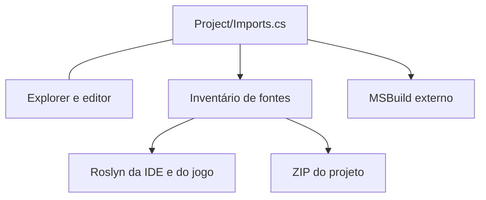

# Lunet Framework — Estudo de importações globais

**Base:** [Ecosystem `952659e8`](https://github.com/AbnerCruz/Ecosystem/commit/952659e8e7f08a3a8ebdd8d60186697aef6c7b5a), 24/11/2026. **Classificação:** recomendada com alterações. A proposta `01-Lunet-importacoes-globais.md` solicita os 26 namespaces, incluindo os inicialmente especializados, e rejeita a proliferação de arquivos à vista, o bloco extenso em `Game.cs` e a injeção invisível. A proposta 02 registra `using static` separadamente. A 03 exige renderização independente das duas conveniências.

**Conclusão.** A opção que concilia as restrições é fonte C# real em pasta normal, apresentada pela IDE sob um grupo de projeto recolhível, com acesso direto ao arquivo e à origem de cada símbolo. Dos 26 nomes exatos, 24 existem nas referências de jogo medidas. As duas diretivas ausentes falham mesmo num jogo vazio. Há colisões entre tipos públicos nos 24 nomes válidos. O perfil amplo cabe como opção explícita depois de fechar a paridade de build. A medição favorece um perfil menor para a primeira experiência.

## I — Auditoria interna

| Caminho | Código e comportamento observados | Consequência |
| --- | --- | --- |
| Fonte, inventário e ZIP | `LunetProject.Walk/ListFiles` excluem `.lunet`, `bin`, `obj` e `.git` em qualquer nível e filtram temporários. `LoadSources` seleciona C# fora de `Tests/`. `ExportZip` copia os arquivos inventariados, com pasta raiz, incluindo meios que não são compilados. [LunetProject, 8–44 e 163–180](https://github.com/AbnerCruz/Ecosystem/blob/952659e8e7f08a3a8ebdd8d60186697aef6c7b5a/apps/lunet2d/src/Lunet.Core/LunetProject.cs#L8-L180). | Uma pasta `Project/` normal cabe no contrato. Usar `.lunet/` faria desaparecer a fonte do Preview e do ZIP. Agrupamento visual precisa manter identidade e caminho real do arquivo. |
| Preview dinâmico | `MainActivity` carrega fontes, chama `GameCompiler.Compile`, e os dois modos de Preview recebem o jogo compilado. `GameCompiler` usa `CSharpCompilation.Create`, opção nullable e árvores de fonte com caminho, armazena árvore por par caminho/texto, elimina removidas e guarda resultado por fingerprint. [MainActivity, 1158–1229](https://github.com/AbnerCruz/Ecosystem/blob/952659e8e7f08a3a8ebdd8d60186697aef6c7b5a/apps/lunet2d/src/Lunet.Android/MainActivity.cs#L1158-L1229) · [GameCompiler, 20–111](https://github.com/AbnerCruz/Ecosystem/blob/952659e8e7f08a3a8ebdd8d60186697aef6c7b5a/apps/lunet2d/src/Lunet.Compiler/GameCompiler.cs#L20-L111) · [ADR 0006](https://github.com/AbnerCruz/Ecosystem/blob/952659e8e7f08a3a8ebdd8d60186697aef6c7b5a/apps/lunet2d/docs/adr/0006-preview-rapido-e-isolado.md). | Um arquivo comum participa do cache existente. Sua edição pode invalidar o binding de todo o projeto mesmo quando as árvores dos outros arquivos são reaproveitadas. |
| Diagnósticos e autocomplete | A abertura do projeto carrega fontes para o assistente do editor. `CodeAnalyzer` mantém sua própria compilação, atualiza árvores e usa modelo semântico e `LookupSymbols`; o caminho de membro inclui extensões reduzidas. [MainActivity, 360–386](https://github.com/AbnerCruz/Ecosystem/blob/952659e8e7f08a3a8ebdd8d60186697aef6c7b5a/apps/lunet2d/src/Lunet.Android/MainActivity.cs#L360-L386) · [CodeAnalyzer](https://github.com/AbnerCruz/Ecosystem/blob/952659e8e7f08a3a8ebdd8d60186697aef6c7b5a/apps/lunet2d/src/Lunet.Editor/CodeAnalyzer.cs). | Edição via painel tem de atualizar o mesmo documento que a fonte, nas operações de escrita, renomeação, desfazer e remoção. Oferecer milhares de nomes sem origem legível pode piorar o autocomplete no celular. |
| APK offline | `RunLocalGameBuild` usa `LoadSources` e o mesmo `SharedCompiler` do Preview, empacotando o assembly num runtime Android preexistente. [MainActivity.GameBuild, 100–159](https://github.com/AbnerCruz/Ecosystem/blob/952659e8e7f08a3a8ebdd8d60186697aef6c7b5a/apps/lunet2d/src/Lunet.Android/MainActivity.GameBuild.cs#L100-L159). | Fonte compartilhada favorece a paridade; obter `Game.dll` ainda não garante referências executáveis no runtime do APK. |
| SDK externo e build cloud | `Lunet.GameCode.csproj` referencia Framework e Networking e passa o glob de `GameSourceRoot` ao C#. Exclui `Tests`, `bin`, `obj` e `.lunet` na raiz. `Directory.Build.props` ativa `ImplicitUsings`, `Nullable` e `TreatWarningsAsErrors`. O workflow de jogo usa esse projeto. [GameCode](https://github.com/AbnerCruz/Ecosystem/blob/952659e8e7f08a3a8ebdd8d60186697aef6c7b5a/apps/lunet2d/runtime-template/Lunet.GameCode.csproj) · [Directory.Build.props](https://github.com/AbnerCruz/Ecosystem/blob/952659e8e7f08a3a8ebdd8d60186697aef6c7b5a/apps/lunet2d/Directory.Build.props) · [GitHubGameBuildWorkflow](https://github.com/AbnerCruz/Ecosystem/blob/952659e8e7f08a3a8ebdd8d60186697aef6c7b5a/apps/lunet2d/src/Lunet.Core/GitHubGameBuildWorkflow.cs). | Já existem diferenças além do nome das fontes. SDK acrescenta diretivas que o Roslyn embutido não sintetiza. Subpastas de cache e caixa de caminhos também exigem comparação de inventário. Diretivas SDK duplicadas podem virar diagnóstico de build conforme a configuração. O ZIP é intercâmbio do projeto, e a compilação externa exige projeto/referências do SDK. |
| Referências, servidor, desktop | `LoadedAssembliesReferenceProvider` tenta carregar assemblies nomeados, inclui `System.*` já carregados e extras como Framework, ignora opcionais ausentes e usa `TryGetRawMetadata`; o resultado é armazenado em cache. `WorkspaceSession` e `lunet-server` montam fontes pelo projeto, e seus projetos referenciam Networking. [ReferenceProvider](https://github.com/AbnerCruz/Ecosystem/blob/952659e8e7f08a3a8ebdd8d60186697aef6c7b5a/apps/lunet2d/src/Lunet.Compiler/LoadedAssembliesReferenceProvider.cs) · [WorkspaceSession](https://github.com/AbnerCruz/Ecosystem/blob/952659e8e7f08a3a8ebdd8d60186697aef6c7b5a/apps/lunet2d/src/Lunet.Host/WorkspaceSession.cs#L75-L106) · [Server](https://github.com/AbnerCruz/Ecosystem/blob/952659e8e7f08a3a8ebdd8d60186697aef6c7b5a/apps/lunet2d/src/Lunet.Server/Program.cs#L44-L65). | `using` não instala pacote ou carrega DLL. O mesmo texto precisa de referências compatíveis; namespaces da IDE/Runtime não devem entrar no jogo para resolver uma lista. |
| Projetos de origem | `ProjectStore.Create` materializa cinco templates de `ProjectTemplates`. `LearningTrackOne` define os desafios e `CreateLearningProject` instancia o template Blank com orientação, mesmo quando as tarefas do curso mencionam outras APIs. [ProjectStore](https://github.com/AbnerCruz/Ecosystem/blob/952659e8e7f08a3a8ebdd8d60186697aef6c7b5a/apps/lunet2d/src/Lunet.Core/ProjectStore.cs#L78-L115) · [LearningTrackOne](https://github.com/AbnerCruz/Ecosystem/blob/952659e8e7f08a3a8ebdd8d60186697aef6c7b5a/apps/lunet2d/src/Lunet.Core/LearningTrackOne.cs) · [MainActivity.Learn](https://github.com/AbnerCruz/Ecosystem/blob/952659e8e7f08a3a8ebdd8d60186697aef6c7b5a/apps/lunet2d/src/Lunet.Android/MainActivity.Learn.cs#L288-L323). | Avaliar código criado e objetivos futuros separadamente. A base não contém uma coleção de soluções de alunos que permita estimar o que eles digitam. |

O [ADR 0002](https://github.com/AbnerCruz/Ecosystem/blob/952659e8e7f08a3a8ebdd8d60186697aef6c7b5a/apps/lunet2d/docs/adr/0002-modelo-de-compilacao-e-camadas.md) descreve a fundação com `System.*`, netstandard e Framework; a implementação passou a admitir `Lunet.Networking`. `SplitScreen`, `TurnOrder` e atributos de inspeção declaram `namespace Lunet`. O inspetor efetivo é `Lunet.Runtime.Inspection` e pertence ao runtime. A presença de pastas `Multiplayer` e `Inspection` gerou nomes sugeridos que não existem na API do jogo. [SplitScreen](https://github.com/AbnerCruz/Ecosystem/blob/952659e8e7f08a3a8ebdd8d60186697aef6c7b5a/apps/lunet2d/src/Lunet.Framework/Multiplayer/SplitScreen.cs#L1-L8) · [TurnOrder](https://github.com/AbnerCruz/Ecosystem/blob/952659e8e7f08a3a8ebdd8d60186697aef6c7b5a/apps/lunet2d/src/Lunet.Framework/Multiplayer/TurnOrder.cs#L1-L12) · [InspectorAttributes](https://github.com/AbnerCruz/Ecosystem/blob/952659e8e7f08a3a8ebdd8d60186697aef6c7b5a/apps/lunet2d/src/Lunet.Framework/Inspection/InspectorAttributes.cs) · [ObjectInspector](https://github.com/AbnerCruz/Ecosystem/blob/952659e8e7f08a3a8ebdd8d60186697aef6c7b5a/apps/lunet2d/src/Lunet.Runtime/Inspection/ObjectInspector.cs).

### Frequência semântica observada

A célula é **D/U**, número de unidades de fonte com uma diretiva de namespace declarada / número com pelo menos um tipo nomeado, construtor de atributo ou método de extensão ligado ao namespace exato. Conta uma vez por arquivo/bloco, inclusive usos com nome qualificado. Não soma todos os nós ou todas as dependências inferidas. Uma extensão ligada conta como uso efetivo; tipos de valores retornados implicitamente, palavras-chave como `int` e operações que não escrevem o símbolo podem ficar fora. Imports estáticos e aliases não contam como declaração de namespace. Imports implícitos do SDK são usados para ligar a suíte, mas seu arquivo gerado não entra nas contagens de fonte.

Corpus versionado: 43 blocos C# de [guias](https://github.com/AbnerCruz/Ecosystem/tree/952659e8e7f08a3a8ebdd8d60186697aef6c7b5a/apps/lunet2d/docs/guides), cinco templates, dez starters do curso inicial, 123 árvores da suíte xUnit e fontes Android vinculadas e quatro jogos `samples/**/Game.cs`. O catálogo da Home aponta jogos externos sem suas fontes no corpus. Snippets de XML, código de produção e projetos de usuário fora do checkout não estão no levantamento. As dez aulas reusam o Blank; seus números são dez unidades de distribuição, com duas variantes de orientação, sem independência estatística. A análise Roslyn 5.9 usa referência .NET 10, Framework, Networking, Box2D.NET e LiteNetLib nos jogos e referências de teste na suíte. Em 42 dos 43 trechos de guia houve diagnóstico de base por analisar fragmentos isolados (181 erros); a coluna é um piso de símbolos resolvidos, sensível a condicionais e variáveis externas. Os outros grupos tiveram zero erros de base, com exceção da demonstração APK, cujo `MathF` depende dos imports implícitos do SDK no teste com referências estáticas. Não usar uma frequência zero como evidência de inutilidade.

| Namespace | Exemplos (43) | Templates (5) | Aulas (10) | Testes (123) | Jogos (4) |
|---|---:|---:|---:|---:|---:|
| `System` | 7/5 | 0/2 | 0/0 | 0/120 | 0/1 |
| `System.Numerics` | 17/18 | 4/4 | 0/0 | 50/47 | 4/4 |
| `System.Collections.Generic` | 2/2 | 2/2 | 0/0 | 0/53 | 0/0 |
| `Lunet` | 21/21 | 5/5 | 10/10 | 6/56 | 4/4 |
| `Lunet.Graphics` | 20/20 | 5/5 | 10/10 | 43/41 | 4/4 |
| `Lunet.Input` | 5/4 | 4/4 | 0/0 | 27/35 | 0/0 |
| `Lunet.Content` | 1/1 | 0/0 | 0/0 | 12/19 | 0/0 |
| `Lunet.Audio` | 1/1 | 2/2 | 0/0 | 2/4 | 1/1 |
| `System.Linq` | 0/0 | 0/0 | 0/0 | 0/72 | 0/0 |
| `System.Text` | 0/0 | 0/0 | 0/0 | 4/11 | 0/0 |
| `System.Text.Json` | 1/1 | 0/0 | 0/0 | 13/18 | 0/0 |
| `System.IO` | 0/0 | 0/0 | 0/0 | 1/86 | 0/0 |
| `Lunet.Physics` | 2/2 | 1/1 | 0/0 | 5/5 | 1/1 |
| `Lunet.Scenes` | 0/0 | 1/1 | 0/0 | 1/1 | 0/0 |
| `Lunet.UI` | 8/8 | 1/1 | 0/0 | 12/12 | 1/1 |
| `Lunet.Pathfinding` | 3/4 | 1/1 | 0/0 | 8/8 | 0/0 |
| `Lunet.Storage` | 0/0 | 0/0 | 0/0 | 4/4 | 0/0 |
| `System.Threading` | 0/0 | 0/0 | 0/0 | 0/17 | 0/0 |
| `System.Threading.Tasks` | 0/0 | 0/0 | 0/0 | 0/16 | 0/0 |
| `System.Diagnostics` | 0/0 | 0/0 | 0/0 | 3/5 | 0/0 |
| `System.Reflection` | 0/0 | 0/0 | 0/0 | 3/26 | 0/0 |
| `System.Collections.Concurrent` | 0/0 | 0/0 | 0/0 | 0/0 | 0/0 |
| `System.Text.RegularExpressions` | 0/0 | 0/0 | 0/0 | 1/3 | 0/0 |
| `Lunet.Networking` | 2/2 | 0/0 | 0/0 | 3/3 | 0/0 |
| `Lunet.Multiplayer` | 0/0 | 0/0 | 0/0 | 0/0 | 0/0 |
| `Lunet.Inspection` | 0/0 | 0/0 | 0/0 | 0/0 | 0/0 |

### Como interpretar os 26 nomes

- **`Lunet` e `Lunet.Graphics`** aparecem em todos os starters, templates e jogos da amostra. **`System.Numerics`** aparece em quatro dos cinco templates e nos quatro jogos. São os candidatos centrais. **`Lunet.Input`** aparece em quatro templates, mesmo com zero nas quatro amostras de jogos, sinal de valor para início e baixa inferência sobre jogos maiores. **`System`** e **`System.Collections.Generic`** oferecem ergonomia transversal e precisam de auditoria específica quando coexistem com o SDK implícito.
- **`Lunet.Content` e `Lunet.Audio`** reduzem qualificações para tipos nomeados; a chamada herdada `Content.LoadTexture` ou `Audio` pode funcionar sem a diretiva correspondente. **`Lunet.Physics`, `Lunet.Scenes`, `Lunet.UI`, `Lunet.Pathfinding`, `Lunet.Storage`** atendem projetos com subsistemas concretos. Faz sentido mostrá-los no perfil amplo e ensinar a ativação por domínio. **`Lunet.Networking`** depende da presença do assembly separado em cada host, apesar de ligado por referência e encontrado no probe Linux. **`Lunet.Multiplayer` e `Lunet.Inspection`** são entradas inviáveis como diretivas exatas; explicar a localização real das APIs, sem criar namespaces artificiais.
- **`System.Linq`, `System.Text`, `System.Text.Json`, `System.IO`** merecem opção visível, com atenção especial a extensões LINQ e aliases em `System.IO`. **`System.Threading`, `System.Threading.Tasks`, `System.Diagnostics`, `System.Reflection`, `System.Collections.Concurrent`, `System.Text.RegularExpressions`** existem nas referências medidas, têm utilidade especializada e ampliam candidatos ou sugerem APIs que podem ter comportamento específico de plataforma. `System.Reflection` importa um homônimo de `Pointer`, e Diagnostics/Threading importam dois `ThreadState`. Ativar um namespace não torna a respectiva API conveniente, portátil ou disponível em todos os cenários.

### Experimentos de compilação observados

| Experimento | Resultado |
| --- | --- |
| 26 globais com `Microsoft.NETCore.App.Ref` do SDK e assemblies de jogo | `CS0234` para `Lunet.Multiplayer` e `Lunet.Inspection`. O mesmo resultado usando o provedor real do Lunet em Linux. |
| Busca de tipos públicos com mesmo nome/aridade nas 24 importações válidas | `Lunet.Input.Pointer` × `System.Reflection.Pointer`, `System.Diagnostics.ThreadState` × `System.Threading.ThreadState`. O erro depende de ocorrência não qualificada e regras de lookup. |
| Dois `Vector2` em namespaces globais distintos no mesmo projeto sintético | `CS0104`, reproduzido com `ThirdParty.Vector2` e `System.Numerics.Vector2`. |
| Extensão `Pilot.Extensions.Count<T>` e nova global de `System.Linq` | `CS0121` numa chamada antes inequívoca. A extensão importada pelo namespace entra no conjunto de candidatos. |
| Pasta real no build SDK e no servidor | Uma cópia temporária de `samples/apk-smoke/Game.cs`, um `lunet.json` válido e as 24 diretivas em `Project/Imports.cs` compilaram com `Lunet.GameCode.csproj -p:GameSourceRoot=<projeto>` (zero avisos/erros) e com `lunet-server <projeto> --check` (4 KiB). O teste valida enumeração da pasta normal e presença dos namespaces em ambos os processos Linux. Não valida app/GPUs Android, nem a igualdade de símbolos usados em toda fonte. |
| Simulação das 24 globais nos cinco templates, dez starters e três jogos compiláveis no probe | Nenhum erro novo ou mudança de símbolo reportada nos nós que ligavam antes e depois; WarnAsError do SDK, pacotes de usuário, fontes Android e generics inferidos em contextos não comparados ficam fora do resultado. |

Para reproduzir, compilar a suíte gera o `Lunet.Tests.GlobalUsings.g.cs` e disponibiliza DLLs para a sonda semântica. Parsear cada fonte com `CSharpSyntaxTree.ParseText` e linguagem Latest. Montar `CSharpCompilation` por treino, template, guia ou jogo, e uma para todo o projeto de testes com o arquivo SDK gerado. Usar `DescendantNodes().OfType<UsingDirectiveSyntax>()` para D, e `GetSemanticModel(tree).GetSymbolInfo(nome)` em `SimpleNameSyntax` fora de diretivas e declarações de namespace para U. Contar o `ContainingNamespace` exato dos `INamedTypeSymbol` resolvidos, aliases de tipos, extensões e construtores de atributos. Para a simulação comparar `GetDiagnostics`, assembly e nome totalmente qualificado do símbolo antes/depois de `AddSyntaxTrees`. A execução semântica usou .NET 10.0.100 e Roslyn 5.9.0.0. Todos os 26 nomes foram tentados em uma árvore com `global using global::<namespace>;` cada.

## II — Pesquisa externa

| Referência examinada | Mecanismo, compromisso e aplicação |
| --- | --- |
| **C# 10, speclet de global using**, especificação §§14.5, 12.8 e 12.9 | A diretiva global é de compilação e afeta nomes acessíveis a partir dos demais arquivos. A importação normal tem corpo de compilação/namespace como escopo. Namespaces não carregam assemblies nem são transitivos; o mesmo namespace pode ser composto de múltiplos assemblies. A posição lexical, nomes próprios e membros de tipos continuam influenciando o binding. Diretivas globais vêm antes das locais e não propagam por herança, projeto de referência ou subnamespace. Alias define um nome lexicamente e `using static` importa membros estáticos e tipos aninhados acessíveis, com regras próprias para extensões. Um `global using static` não torna uma instância disponível sem API de execução. [Speclet](https://learn.microsoft.com/dotnet/csharp/language-reference/proposals/csharp-10.0/globalusingdirective) · [Namespaces](https://learn.microsoft.com/dotnet/csharp/language-reference/language-specification/namespaces) · [Expressões e lookup](https://learn.microsoft.com/dotnet/csharp/language-reference/language-specification/expressions). |
| **SDK .NET**, `5db7f0f1` | O SDK expande seus itens `Using` por uma tarefa MSBuild. `GenerateGlobalUsings` forma diretivas C# a partir das entradas, com `Static`/alias e ordenação/deduplicação, e os targets adicionam a saída intermediária aos itens compilados. Testes do SDK cobrem defaults, customização e desativação. Resolve bootstrap de projetos no SDK. No Lunet exigiria equivalência do MSBuild em compilação dinâmica e IDE, sem ganho equivalente para um arquivo simples. [Task](https://github.com/dotnet/sdk/blob/5db7f0f18d18c99acfa82e6663a84b1122195380/src/Tasks/Microsoft.NET.Build.Tasks/GenerateGlobalUsings.cs) · [Targets](https://github.com/dotnet/sdk/blob/5db7f0f18d18c99acfa82e6663a84b1122195380/src/Tasks/Microsoft.NET.Build.Tasks/targets/Microsoft.NET.GenerateGlobalUsings.targets) · [Testes](https://github.com/dotnet/sdk/blob/5db7f0f18d18c99acfa82e6663a84b1122195380/test/Microsoft.NET.Build.Tests/GivenThatWeWantToGenerateGlobalUsings_DotNet.cs). |
| **Roslyn** | O binder usa escopos e aliases de C#. A suíte semântica testa interação entre árvores, alias, extensões e duplicidade. Source generators são outra via para adicionar árvores, via driver, precisam entrar em cada compilação e não mudam a gramática. Não presumir que `CSharpCompilation.Create` executa MSBuild, geradores ou regras de templates. Preferir o mecanismo já exercitado em cada árvore e definir um teste de invalidação semântica. [GlobalUsingDirectiveTests](https://github.com/dotnet/roslyn/blob/20b549bac1409a0df9f4575557c71f6a7e506989/src/Compilers/CSharp/Test/Semantic/Semantics/GlobalUsingDirectiveTests.cs) · [Source Generator Design](https://github.com/dotnet/roslyn/blob/20b549bac1409a0df9f4575557c71f6a7e506989/docs/features/source-generators.md). |
| **MonoGame** | O template Android traz imports locais de Framework, Graphics e Input. `Game1` herda Game e pode usar Content, mas declara à parte os namespaces dos tipos. O template ajuda o primeiro jogo com fonte visível. A identidade própria de tipos XNA favorece a compatibilidade histórica do MonoGame e não justifica copiar tipos de `System.Numerics` no Lunet. [Template Android `ac8fc147`](https://github.com/MonoGame/MonoGame.Templates/blob/ac8fc14785862b4cbe6592aa19c3d7ee2e1ecc70/CSharp/content/MonoGame.Application.Android.CSharp/Game1.cs). |
| **FNA** | A classe Game de FNA usa diretivas locais para XNA Audio, Input, Graphics e Content mesmo herdando o modelo XNA. O namespace público concentra tipos de raiz e deixa subsistemas em filhos. Sustenta compatibilidade de consumidores XNA; essa decisão de identidade e distribuição não elimina imports do consumidor. [Game `852e4af7`](https://github.com/FNA-XNA/FNA/blob/852e4af70e98a1fbba1f34c3a7adf5e8430ce93e/src/Game.cs). |
| **Raylib-cs** | O projeto SDK dos exemplos declara `Raylib_cs`, `System.Numerics` e a forma estática de `Raylib_cs.Raylib` com itens `Using`. O exemplo básico usa os nomes diretamente. A classe de interop liga métodos à biblioteca nativa. A API plana reduz prefixos, mas traz um conjunto muito largo de funções para o escopo. Replicar a opção de `using static` é barato; importar uma fachada de execução para o projeto inteiro exige revisão de colisões e lifecycle. [BasicWindow](https://github.com/raylib-cs/raylib-cs/blob/022e559ea5b1943fcb1c3daf06fbfacab014ade4/Examples/Core/BasicWindow.cs) · [Examples.csproj](https://github.com/raylib-cs/raylib-cs/blob/022e559ea5b1943fcb1c3daf06fbfacab014ade4/Examples/Examples.csproj) · [Interop](https://github.com/raylib-cs/raylib-cs/blob/022e559ea5b1943fcb1c3daf06fbfacab014ade4/Raylib-cs/interop/Raylib.cs). |
| **Godot C#** | O template de `CharacterBody2D` substitui tokens na versão real do script, emitindo imports de bindings e `System`. O SDK agrega referências e opções necessárias ao host. Usa sequência template → fonte explícita; SDK não é autorização para assumir paridade entre caminhos de build arbitrários. [Template](https://github.com/godotengine/godot/blob/a661dfdbccc664ccca57ad76c2bb5dcd8f3fc768/modules/mono/editor/script_templates/CharacterBody2D/basic_movement.cs) · [Sdk.props](https://github.com/godotengine/godot/blob/a661dfdbccc664ccca57ad76c2bb5dcd8f3fc768/modules/mono/editor/Godot.NET.Sdk/Godot.NET.Sdk/Sdk/Sdk.props). |
| **Unity** | `LoadingAssemblyDefinition` interpreta definições/referências de assemblies separadas dos imports em C#. O ecossistema usa assemblies definidos na ferramenta para dependência e compilação seletiva. Útil para clareza de fronteira; um formato equivalente para controlar nomes seria custo desnecessário. Na versão Unity 6.0 documentada, o teto C# 9 afeta `global using`; isso ilustra o acoplamento à versão do compilador e não descreve automaticamente o Unity 7000 do snapshot de código. [LoadingAssemblyDefinition](https://github.com/Unity-Technologies/UnityCsReference/blob/cf583fbe6da6b9fb11e3a1ac03f23df4eb120e9b/Editor/Mono/Scripting/ScriptCompilation/LoadingAssemblyDefinition.cs) · [Manual 6000.0](https://docs.unity3d.com/6000.0/Documentation/Manual/csharp-compiler.html). |
| **Stride** | `BasicCameraController` usa imports locais de Core, Mathematics, Engine, Input e herança de SyncScript. O template fornece contexto por código e distingue os namespaces especialistas. Um perfil por jogo ajuda a quem usa apenas parte do framework; os tipos matemáticos próprios não são uma exigência para dar a mesma ergonomia no Lunet. [BasicCameraController](https://github.com/stride3d/stride/blob/659bb239e5935aadac17b68bea9a6d31cf7736cd/samples/NewGame/NewGame/MyTemplate.Game/BasicCameraController.cs). |
| **Visual Studio** | Solution Explorer pode aninhar arquivos por convenções e a IDE mantém arquivos reais editáveis. É evidência de um padrão de UX, não prova de que o seu formato JSON ou hierarquia sejam bons para tela pequena. Um nó único da IDE que navega para a fonte basta como primeira hipótese. [File nesting](https://learn.microsoft.com/visualstudio/ide/file-nesting-solution-explorer). |

## III — Evidência comunitária

- O [relato do SDK Web #20747](https://github.com/dotnet/sdk/issues/20747) mostra `ILogger` ambíguo com bibliotecas de logging na migração. É um exemplo concreto de ruptura de fonte em código sem mudança local. O [aviso de compatibilidade #25066](https://github.com/dotnet/docs/issues/25066) documenta a intenção de reduzir boilerplate e o risco de conflito desde a introdução. A força dessa evidência vem do diagnóstico reproduzível, sem extrapolar a frequência para jogos.
- No [Roslyn #24096](https://github.com/dotnet/roslyn/issues/24096), duas extensões igualmente aplicáveis produzem CS0121 e a melhoria de IDE foi fechada como não planejada. O caso exige qualificação ou chamada estática explícita. Preencher autocomplete com extensões de vários subsistemas não melhora leitura automaticamente.
- O [Godot-MCP #474](https://github.com/IvanMurzak/Godot-MCP/issues/474) relata `Godot.FileAccess` × `System.IO.FileAccess` e `Godot.Timer` × `System.Threading.Timer` ao compilar fontes de addon no projeto host. O raio de impacto de uma diretiva global inclui código importado textualmente. É relato reproduzível de integração, não evidência de falha em um jogo Lunet.
- A [discussão Unity 6.0](https://discussions.unity.com/t/global-using-directive-issue/1643578) traz CS8773 para uma versão de linguagem anterior ao C# 10. É evidência de experiência de migração; a configuração suportada é definida pelo manual da versão. Uma rotina de templates precisa respeitar a versão efetiva de linguagem nos seis caminhos Lunet.

## IV — Confronto crítico

O problema é recorrente para tipos centrais, com evidência menor para o conjunto completo. A economia de linhas é real e a execução do mesmo programa ligado aos mesmos símbolos não recebe trabalho extra por uma diretiva. O risco relevante é mudar o programa ligado. Projetos antigos podem compilar com um overload diferente, quebrar de forma explícita ou sofrer diferença Preview × SDK. O tempo de compilação e completion após mudar um global ainda não foi medido. No celular, também importa se o aluno consegue descobrir onde o tipo mora ou remover uma entrada sem navegar pela árvore inteira.

| Alternativa | Benefício e perda | Classificação |
| --- | --- | --- |
| Continuar com imports locais | Máxima localidade e nenhuma alteração. Mantém repetição em tipos frequentes entre vários arquivos. | **Recomendada** como opção e para projetos existentes. |
| Bloco `#region` de globais em `Game.cs` | Um único arquivo em disco. A região é apresentação, depende de editor que recolhe e mantém o bloco no ponto de entrada ao abrir externamente. | **Adiada** como convenção de template. Livre escolha do autor. |
| Arquivo `GlobalUsings.cs` solto na raiz | Menor engenharia para uma única autoridade. Custa uma linha permanente a mais na árvore, a objeção específica do proprietário. | **Recomendada com alterações**: agrupar por projeto e manter opção de árvore física. |
| `Project/Imports.cs` sob nó recolhível `Projeto` | Fonte real, Git diff direto, troca e remoção pela interface e qualquer editor. Requer tratamento de menus de edição, procura, estado de recolhimento e menus do Android. | **Recomendada com alterações**, caminho principal para um teste futuro. O nome/pasta são ilustrativos. |
| Painel de checkboxes como projeção da fonte | Reduz digitação no celular. Precisa preservar comentários, aliases, `#if`, ordem e formatação. Se o painel não entender um trecho, oferecer fonte e edição sem perder conteúdo. | **Experimental**. Procurar evidência de necessidade antes de desenvolver editor bidirecional. |
| Itens `<Using>` num `.csproj` existente | Configuração visível no SDK. O projeto de jogo no Lunet parte de `lunet.json` e uma pasta de fontes. Exigiria um avaliador ou tradução no Preview e IDE, além de suporte a aliases e condicionais. | **Adiada**. Reavaliar só se o jogo ganhar um projeto SDK canônico compartilhado por seus caminhos. |
| Manifesto adicional, gerador ou fonte invisível | Elimina linhas aparentes, adiciona um segundo mecanismo para cada host, ferramentas externas e cache. Fonte gerada que entra duas vezes por glob ou não acompanha o manifesto introduz divergência. | **Rejeitada** como padrão. |
| Reexportar tipos .NET em `Lunet` | Tipos duplicados quebram identidade, extensões, serialização e interoperabilidade. Type forwarding muda localização de assembly mantendo o mesmo nome completo, sem replicar uma importação. | **Rejeitada**. |
| Aplicar as 26 exatas automaticamente | Duas falham já no jogo vazio; outras ampliam ambiguidades e dependem de referências por host. | **Rejeitada** no snapshot. **Experimental** como perfil amplo revisado e opt-in depois da matriz. |

Exemplo de organização portátil. Os arquivos a seguir usam APIs atuais e são ilustrativos, com `Importações` na IDE abrindo `Project/Imports.cs`. Ciclo de jogo e seleção do lote permanecem no ponto de entrada.

```csharp
// Project/Imports.cs
global using System.Numerics;
global using Lunet;
global using Lunet.Graphics;
global using AppPointer = Lunet.Input.Pointer;
```

```csharp
// Game.cs
public sealed class MeuJogo : Game
{
    protected override void Draw(GameTime time)
    {
        GraphicsDevice.Clear(Color.Black);
    }
}
```

```csharp
// Player.cs
public sealed class Player
{
    public Vector2 Position { get; private set; }
    public void Move(Vector2 offset) => Position += offset;
}
```

Para diagnosticar `Pointer`, o usuário pode preferir `Lunet.Input.Pointer` na própria linha ou editar o alias `AppPointer`. Uma extensão em colisão pode ser chamada como método estático qualificado, por exemplo `System.Linq.Enumerable.Count(itens)`. Um arquivo de globals explícito com `global using static Lunet.Context` seria uma escolha futura da aplicação, dependente de aprovação do Tema II e de teste de resolução com membros herdados como Content/Input/Services.



## V — Consolidação e condições de validação futura

1. **Manter o arquivo como autoridade única** e demonstrar edição visível, copiar referência, Git diff, desfazer e acesso em ZIP. Exibir nome qualificado e assembly de tipos ambíguos. Distinguir ausência de namespace de ausência de referência. Comparar lista física entre inventários em nomes e bytes.
2. **Oferecer controle do conjunto**, incluindo os 24 nomes tecnicamente disponíveis no ambiente medido, após validar por plataforma e por perfil. Métrica para decidir defaults: número de arquivos/usuários beneficiados, taxa de erros/alterações de binding, impacto no autocomplete e latência. O perfil inicial deve ser formado por dados de código, sem inventar corte estatístico. Usar o mesmo perfil em edição e execução.
3. **Cobrir paridade semântica** com um jogo de duas fontes, alias, extensão, nome local homônimo e uma dependência opcional. Comparar diagnóstico e `ISymbol` qualificado antes/depois da edição e remoção. Duplicatas de usings, `Directory.Build.props`, `TreatWarningsAsErrors`, `LangVersion`, dependência incompatível e `#if` merecem casos próprios. Testar dois repos/módulos que compilam separadamente e um projeto legado exportado.
4. **Cobrir as rotas de entrega** com Preview rápido e isolado, autocomplete e erros em arquivos irmãos, ZIP ida e volta, APK offline, build cloud, SDK externo, desktop e servidor. Medir arquivo alterado e arquivo removido em cache quente e frio. Usar [ProjectJourneyTests](https://github.com/AbnerCruz/Ecosystem/blob/952659e8e7f08a3a8ebdd8d60186697aef6c7b5a/apps/lunet2d/tests/Lunet.Tests/ProjectJourneyTests.cs) e [ArchitectureTests](https://github.com/AbnerCruz/Ecosystem/blob/952659e8e7f08a3a8ebdd8d60186697aef6c7b5a/apps/lunet2d/tests/Lunet.Tests/ArchitectureTests.cs) como cobertura de fundação. Reprovar qualquer perfil que silenciosamente troque símbolo em código preservado.
5. **Questões abertas.** Sem teste Android das referências nos dois APKs. Sem corpus de projetos de usuário ou dados de aceitação da projeção em tela pequena. O ponto de desativação dos imports implícitos do SDK ainda precisa ser escolhido e comparado com projetos exportados antigos, incluindo `MathF` em `samples/apk-smoke`. O comportamento de cada integração fora de Android/Linux mede-se separadamente; navegador/iOS não entram como suporte verificado. O custo para grandes projetos e a forma de dar acesso a aliases condicionais na IDE permanecem hipóteses.
