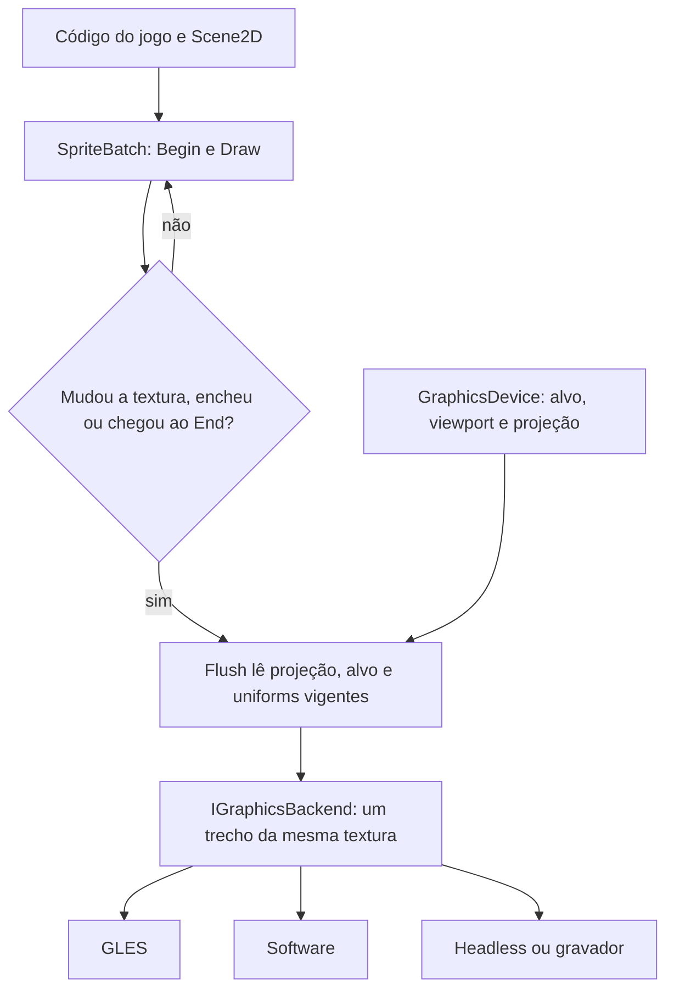
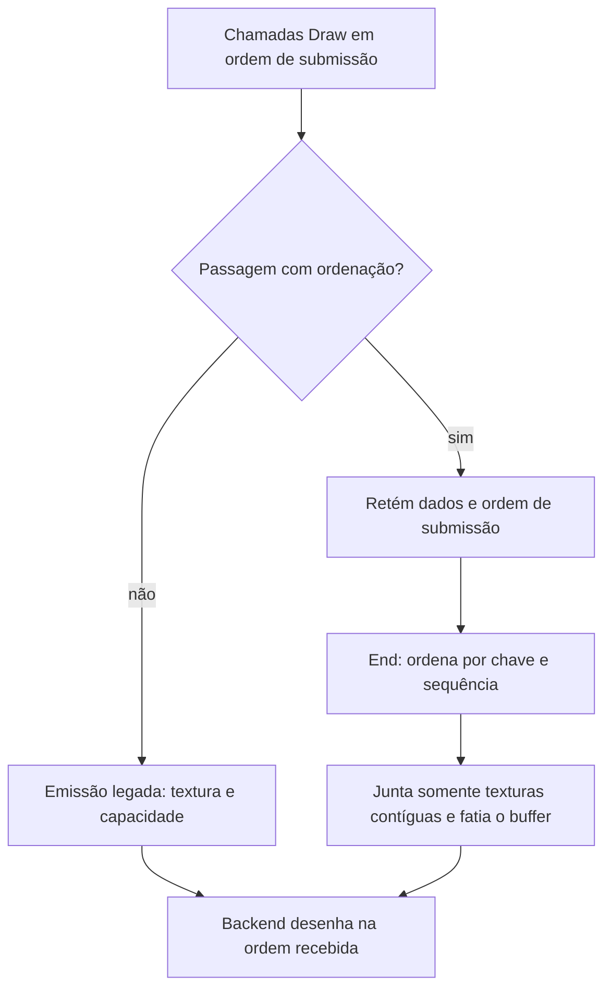

# Lunet Framework — Estudo de ordenação de renderização

**Base canônica auditada:** [Ecosystem `952659e8e7f08a3a8ebdd8d60186697aef6c7b5a`](https://github.com/AbnerCruz/Ecosystem/tree/952659e8e7f08a3a8ebdd8d60186697aef6c7b5a/apps/lunet2d), 24/11/2026. Este estudo distingue leitura de fonte, relato externo, dedução e proposta a validar. A API ilustrativa é hipótese de contrato. As três propostas de origem foram lidas integralmente e preservadas.

## Contexto e conclusão

A prioridade é poder enviar sprites em ordem de simulação conveniente e compô-los em outra ordem **dentro de uma passagem gráfica**, sem obrigar um jogo a construir seu próprio coletor. O caso de referência é um personagem que passa atrás e à frente de uma árvore: o pé do personagem e a base do tronco determinam a oclusão. A ordem de chamadas existente resolve cenas pequenas e continua sendo o contrato padrão. A lacuna aparece ao precisar ordenar submissões distribuídas entre componentes, texturas, fontes e mapas.

**Classificação: recomendada com alterações.** Investigar um caminho opt-in por chave estável no lote lógico completo, com limites explícitos de passagem e preservação das assinaturas e do momento dos envios legados. Preservar a ordem de submissão entre empates, antes de agrupar texturas consecutivas. Tratar Y-sort, camadas semânticas e grupos de peças na organização da cena/jogo, onde seus pontos de apoio e relações existem. A nomenclatura do MonoGame orienta a comparação, mas não obriga o Lunet a replicar todos os modos.

## Etapa I — Auditoria interna

### Entrada, submissão, envio e backends

| Ponto verificado | Comportamento e consequência |
|---|---|
| [`SpriteBatch.cs` L14–54](https://github.com/AbnerCruz/Ecosystem/blob/952659e8e7f08a3a8ebdd8d60186697aef6c7b5a/apps/lunet2d/src/Lunet.Framework/Graphics/SpriteBatch.cs#L14-L54) | Classe selada, associada ao dispositivo pelo construtor. Buffer reutilizado de 2.048 quads × 4 vértices, uma textura corrente e sem fila de comandos ou valor Z. A abertura valida reentrada na instância e shader descartado, guarda blend, sampler, handle do shader e scissor em pixels. |
| [`SpriteBatch.cs` L56–98](https://github.com/AbnerCruz/Ecosystem/blob/952659e8e7f08a3a8ebdd8d60186697aef6c7b5a/apps/lunet2d/src/Lunet.Framework/Graphics/SpriteBatch.cs#L56-L98) | As três outras entradas compõem o estado fundamental: câmera captura matriz com o tamanho do alvo em `Begin`, split screen usa tamanho da região e recorte correspondente, material encaminha blend/sampler/shader. Cada câmera ou material diferente pede sua própria passagem explícita. |
| [`SpriteBatch.Draw` e `Corner` L100–168](https://github.com/AbnerCruz/Ecosystem/blob/952659e8e7f08a3a8ebdd8d60186697aef6c7b5a/apps/lunet2d/src/Lunet.Framework/Graphics/SpriteBatch.cs#L100-L168) | As entradas por textura e posição chegam a um emissor que valida estado, converte origem/escala/rotação/UV, grava quatro vértices e aplica a câmera na CPU. Mudança de instância de textura ou próximo quad após saturar o buffer descarrega antes de adicionar ao lote. `A, B, A` implica até três chamadas mesmo com três sprites. |
| [`SpriteBatch.End/Flush` L224–241](https://github.com/AbnerCruz/Ecosystem/blob/952659e8e7f08a3a8ebdd8d60186697aef6c7b5a/apps/lunet2d/src/Lunet.Framework/Graphics/SpriteBatch.cs#L224-L241) | `End` exige abertura, envia o resto e fecha. `Flush` privado lê projeção do dispositivo e dicionário atual de uniforms, então chama `SetDrawState` e `DrawQuads` antes de limpar contadores e referência. Exceção do backend interrompe a sequência antes da limpeza. Não há método de cancelamento, API pública de flush, validação de ordem entre batches do mesmo dispositivo, nem snapshot profundo de uniforms. |
| [`GraphicsDevice` L49–74 e L135–238](https://github.com/AbnerCruz/Ecosystem/blob/952659e8e7f08a3a8ebdd8d60186697aef6c7b5a/apps/lunet2d/src/Lunet.Framework/Graphics/GraphicsDevice.cs#L135-L238) | Alvo atual determina `ViewSize`; projeção virtual vs. render target inverte o eixo Y no alvo. `SetRenderTarget` aplica imediatamente binding, viewport e projeção, sem consulta ao batch. `Clear` modifica o alvo imediatamente; resize/escala/recuos recalculam projeção e parâmetros virtuais. Scissor de tela e FBO têm transformações distintas. A combinação câmera/scissor antigos e projeção/alvo novos é possível se o jogo altera destino antes de `End`. |
| [`IGraphicsBackend.cs` L15–73](https://github.com/AbnerCruz/Ecosystem/blob/952659e8e7f08a3a8ebdd8d60186697aef6c7b5a/apps/lunet2d/src/Lunet.Framework/Graphics/IGraphicsBackend.cs#L15-L73) e [`SpriteVertex.cs` L13–23](https://github.com/AbnerCruz/Ecosystem/blob/952659e8e7f08a3a8ebdd8d60186697aef6c7b5a/apps/lunet2d/src/Lunet.Framework/Graphics/SpriteVertex.cs#L13-L23) | O backend recebe um span de quatro vértices consecutivos por quad, uma textura, projeção e um estado aplicado separadamente. Cada vértice carrega posição 2D, UV e RGBA em 20 bytes. Não há chave de ordenação no backend. O buffer legível da instância corresponde a 163.840 bytes de dados de vértice, sem contar objeto, cabeçalhos e reservas do backend. |
| [`GlesBackend.cs` L82–126, L169–255 e L257–307](https://github.com/AbnerCruz/Ecosystem/blob/952659e8e7f08a3a8ebdd8d60186697aef6c7b5a/apps/lunet2d/src/Lunet.Android/Gles/GlesBackend.cs#L82-L255) | GLES 3 usa VAO, VBO dinâmico e índice estático de 16 bits com seis índices por quad; cada envio copia os vértices para staging, atualiza o VBO e chama `GlDrawElements`. Teste de profundidade desativado, textura/filtro/scissor/shader/blend configurados por passagem ou envio. FBO tem attachment de cor. Contadores de chamadas e triângulos quando profiler ativo. |
| [`PreviewRenderer.cs` L119–149, L180–225](https://github.com/AbnerCruz/Ecosystem/blob/952659e8e7f08a3a8ebdd8d60186697aef6c7b5a/apps/lunet2d/src/Lunet.Android/Gles/PreviewRenderer.cs#L119-L225) e [`Lunet.Game.Android.csproj` L25–35](https://github.com/AbnerCruz/Ecosystem/blob/952659e8e7f08a3a8ebdd8d60186697aef6c7b5a/apps/lunet2d/runtime-template/Lunet.Game.Android.csproj#L25-L35) | O APK independente vincula os mesmos arquivos de PreviewRenderer e GlesBackend. Isso dá a ambos o mesmo pipeline de batching em fonte, sem substituir a verificação de empacotamento, superfície e ciclo de vida em cada host. |
| [`SoftwareGraphicsBackend.cs` L81–148 e L293–305](https://github.com/AbnerCruz/Ecosystem/blob/952659e8e7f08a3a8ebdd8d60186697aef6c7b5a/apps/lunet2d/src/Lunet.Runtime/SoftwareGraphicsBackend.cs#L81-L148), [`WorkspaceSession.cs` L95–105](https://github.com/AbnerCruz/Ecosystem/blob/952659e8e7f08a3a8ebdd8d60186697aef6c7b5a/apps/lunet2d/src/Lunet.Host/WorkspaceSession.cs#L95-L105) e [`HeadlessGraphicsBackend.cs` L19–98](https://github.com/AbnerCruz/Ecosystem/blob/952659e8e7f08a3a8ebdd8d60186697aef6c7b5a/apps/lunet2d/src/Lunet.Framework/Graphics/HeadlessGraphicsBackend.cs#L19-L98) | Software percorre quads em ordem, rasteriza sem GPU e contabiliza shaders ignorados. Headless registra totais, sem imagem ou sequência. São instrumentos diferentes, por isso é necessário usar também o backend gravador para verificar sequência e estados. |



A leitura de alvo ocorre indiretamente: o backend usa o framebuffer/alvo ligado, enquanto o batch só passa a projeção. Isso explica por que mudar a API padrão para «enviar sempre em End» quebraria operações que observam o momento do envio mesmo se duas cenas simples produzissem a mesma imagem.

### Consumidores e granularidade

| Consumidor | Situação confirmada | O que um modo ordenado precisa preservar ou explicitar |
|---|---|---|
| Atlas e sprite | `Draw(TextureAtlas,…)` calcula pivô da região e encaminha para textura do atlas. `Draw(Sprite,…)` usa origem, escala e rotação do sprite. [`SpriteBatch.cs` L184–210](https://github.com/AbnerCruz/Ecosystem/blob/952659e8e7f08a3a8ebdd8d60186697aef6c7b5a/apps/lunet2d/src/Lunet.Framework/Graphics/SpriteBatch.cs#L184-L210) | Ordenar um item por chave explícita. O pivô gráfico pode ajudar a definir uma âncora de mundo, mas uma região centrada ou um sprite inclinado não revela automaticamente o ponto no chão. Atlas ajuda a agrupar sem reordenar. |
| Fonte | `DrawString` delega ao `SpriteFont`, que emite quads de glifos na mesma textura, com caminhos para fonte incorporada e customizada. [`SpriteFont.cs` L245–334](https://github.com/AbnerCruz/Ecosystem/blob/952659e8e7f08a3a8ebdd8d60186697aef6c7b5a/apps/lunet2d/src/Lunet.Framework/Graphics/SpriteFont.cs#L245-L334) | Chave por texto e desempate pela emissão preservam o conjunto, inclusive se o texto exceder a capacidade física. Y implícito por glifo deixa linha vizinha ou sprites externos entrarem entre letras. |
| Nine-slice e debug | Nine-slice gera até nove partes. Debug usa a textura branca e desenha linhas/círculos como vários quads. [`NineSlice.cs` L59–90](https://github.com/AbnerCruz/Ecosystem/blob/952659e8e7f08a3a8ebdd8d60186697aef6c7b5a/apps/lunet2d/src/Lunet.Framework/Graphics/NineSlice.cs#L59-L90), [`DebugDraw.cs` L21–85](https://github.com/AbnerCruz/Ecosystem/blob/952659e8e7f08a3a8ebdd8d60186697aef6c7b5a/apps/lunet2d/src/Lunet.Framework/Graphics/DebugDraw.cs#L21-L84) | Um painel é uma unidade visual. Debug normalmente pertence ao último passe; combinar arbitrariamente com arte pelo identificador da textura branca muda o resultado visual. |
| Partículas | `ParticleEmitter.Draw` emite os itens do array ativo com a textura do emissor e valores calculados naquele momento (posição, tamanho, rotação, cor). [`ParticleEmitter.cs` L85–129, L195–213](https://github.com/AbnerCruz/Ecosystem/blob/952659e8e7f08a3a8ebdd8d60186697aef6c7b5a/apps/lunet2d/src/Lunet.Framework/Graphics/ParticleEmitter.cs#L195-L213) | Preservar a emissão interna se a unidade for um emissor. Ordenação individual é escolha separada e pode custar mais que o próprio emissor, sobretudo com partículas translúcidas e fill rate alto. |
| Tilemap | `TileMap.Draw` recorta pela região visível, percorre camadas visíveis em ordem, depois linhas/células, e emite UV do tileset. A ordem das camadas pertence ao mapa. [`TileMap.cs` L164–203, L302–314](https://github.com/AbnerCruz/Ecosystem/blob/952659e8e7f08a3a8ebdd8d60186697aef6c7b5a/apps/lunet2d/src/Lunet.Framework/Graphics/TileMap.cs#L164-L203) | Um lote ordenado por Y de destino poderia misturar chão, cobertura e colisão visual. Fundo e cobertura podem ser passagens separadas. Árvores ou paredes que intercalam com atores precisam da âncora semântica e emissão seletiva. |
| Cena e componentes | `Scene2D.Draw` percorre entidades e `Entity2D.Draw` componentes visíveis em ordem de inserção. Ligações e mutações de travessia são geridas pela cena. O chamador fornece `SpriteBatch` e controla `Begin/End`. [`Scene2D.cs` L71–116, L177–224](https://github.com/AbnerCruz/Ecosystem/blob/952659e8e7f08a3a8ebdd8d60186697aef6c7b5a/apps/lunet2d/src/Lunet.Framework/Scenes/Scene2D.cs#L71-L116) | Reordenar quads após coleta preserva ordem da chamada de componentes. Reordenar diretamente callbacks muda semântica observável e não deve ser a implementação invisível de Y-sort. Uma fila de itens visuais pode coletar separadamente dos callbacks. |
| Vida dos materiais e recursos | `Shader.Set*` atualiza arrays no dicionário; `Shader.Dispose`, `Texture2D.Dispose` e `RenderTarget2D.Dispose` liberam diretamente pelo backend. O render target é dono da textura backing, enquanto o batch mantém referências emprestadas. [`Shader.cs` L35–121](https://github.com/AbnerCruz/Ecosystem/blob/952659e8e7f08a3a8ebdd8d60186697aef6c7b5a/apps/lunet2d/src/Lunet.Framework/Graphics/Shader.cs#L35-L121), [`Texture2D.cs` L89–98](https://github.com/AbnerCruz/Ecosystem/blob/952659e8e7f08a3a8ebdd8d60186697aef6c7b5a/apps/lunet2d/src/Lunet.Framework/Graphics/Texture2D.cs#L89-L98), [`RenderTarget2D.cs` L18–59](https://github.com/AbnerCruz/Ecosystem/blob/952659e8e7f08a3a8ebdd8d60186697aef6c7b5a/apps/lunet2d/src/Lunet.Framework/Graphics/RenderTarget2D.cs#L18-L58) | A janela entre submissão e GPU aumenta quando o lote passa a reter todo o escopo. Segurar uma referência gerenciada não impede `Dispose`, e guardar somente `Handle` pode tocar um recurso novo após reaproveitamento pelo driver. O contrato precisa manter vivos alvo, shader e texturas durante a passagem e rejeitar de forma previsível mutações incompatíveis. A API atual não compara a origem do dispositivo de textura, shader ou target no uso do batch. Handles são locais ao backend e valores iguais em dois hosts não provam identidade de recurso. Qualquer verificação adicional no modo opt-in precisa evitar regressão da API explícita. |

### Testes e decisões de base

- [`FrameworkTests.cs` L157–225](https://github.com/AbnerCruz/Ecosystem/blob/952659e8e7f08a3a8ebdd8d60186697aef6c7b5a/apps/lunet2d/tests/Lunet.Tests/FrameworkTests.cs#L157-L225) fixa agrupamento, capacidade, geometria, rotação e erros de uso. [`CameraTests.cs` L194–300](https://github.com/AbnerCruz/Ecosystem/blob/952659e8e7f08a3a8ebdd8d60186697aef6c7b5a/apps/lunet2d/tests/Lunet.Tests/CameraTests.cs#L194-L300) cobre snapshot de câmera, múltiplos flushes, HUD, clip e render targets. [`GraphicsStateTests.cs` L65–171](https://github.com/AbnerCruz/Ecosystem/blob/952659e8e7f08a3a8ebdd8d60186697aef6c7b5a/apps/lunet2d/tests/Lunet.Tests/GraphicsStateTests.cs#L65-L171) testa targets, shader, uniforms e material. [`SceneTests.cs` L57–92](https://github.com/AbnerCruz/Ecosystem/blob/952659e8e7f08a3a8ebdd8d60186697aef6c7b5a/apps/lunet2d/tests/Lunet.Tests/SceneTests.cs#L57-L92) fixa a ordem de travessia.
- [`RecordingBackend.cs` L8–65](https://github.com/AbnerCruz/Ecosystem/blob/952659e8e7f08a3a8ebdd8d60186697aef6c7b5a/apps/lunet2d/tests/Lunet.Tests/RecordingBackend.cs#L8-L65) registra texturas/vértices/estados/alvos em listas separadas, descarta a projeção recebida e guarda o `DrawState` com a referência original aos uniforms. Para um teste causal é necessário um gravador que intercale eventos e copie os uniforms mutáveis no ato. [`SoftwareRendererTests.cs` L31–87](https://github.com/AbnerCruz/Ecosystem/blob/952659e8e7f08a3a8ebdd8d60186697aef6c7b5a/apps/lunet2d/tests/Lunet.Tests/SoftwareRendererTests.cs#L31-L87) examina RGB, composição simples e alvos. Asserções de ausência de alocação aparecem em [`PerformanceTests.cs` L78–107](https://github.com/AbnerCruz/Ecosystem/blob/952659e8e7f08a3a8ebdd8d60186697aef6c7b5a/apps/lunet2d/tests/Lunet.Tests/PerformanceTests.cs#L78-L107) e nos testes de câmera, partículas e nine-slice. Isso dá uma base histórica para regressão, sem medir algoritmos futuros.
- O contrato de cenas opcionais e o alvo GLES constam no [SPEC §7](https://github.com/AbnerCruz/Ecosystem/blob/952659e8e7f08a3a8ebdd8d60186697aef6c7b5a/apps/lunet2d/docs/SPEC.md#L262-L330). O [guia Gráficos](https://github.com/AbnerCruz/Ecosystem/blob/952659e8e7f08a3a8ebdd8d60186697aef6c7b5a/apps/lunet2d/docs/guides/graficos.md#L1-L22) apresenta agrupamento e desenho explícito, sem especificar quando ocorrem todos os flushes. O histórico técnico da câmera está associado a [LUNET-403](https://github.com/AbnerCruz/Ecosystem/blob/952659e8e7f08a3a8ebdd8d60186697aef6c7b5a/apps/lunet2d/ROADMAP.md#L316), PR [#295](https://github.com/AbnerCruz/Ecosystem/pull/295).
- As observações preliminares sobre capacidade, ordenação por chamadas e ausência de ordenação automática foram confirmadas. Há ressalvas à formulação histórica. O batch atual não é o `Deferred` de MonoGame em tempo de envio. E o exemplo com `List.Sort` somente por Y não garante preservação em empate, pois o [contrato de `List<T>.Sort`](https://learn.microsoft.com/en-us/dotnet/api/system.collections.generic.list-1.sort) descreve ordenação instável. Há uma divergência explícita de código e comentário. [`Shader.Set` L87–92](https://github.com/AbnerCruz/Ecosystem/blob/952659e8e7f08a3a8ebdd8d60186697aef6c7b5a/apps/lunet2d/src/Lunet.Framework/Graphics/Shader.cs#L87-L92) menciona cópia do dicionário em cada Begin, mas [`SpriteBatch.Flush` L232–240](https://github.com/AbnerCruz/Ecosystem/blob/952659e8e7f08a3a8ebdd8d60186697aef6c7b5a/apps/lunet2d/src/Lunet.Framework/Graphics/SpriteBatch.cs#L232-L240) lê o dicionário vivo na hora do envio.

**Execução local da base.** Em Linux, SDK .NET 10.0.100, build Release com zero erros e avisos. O runner xUnit v3 executou 133 casos das nove classes abaixo. Em duas execuções, uma com paralelismo padrão e outra sem paralelismo, 132 passaram e `FrameworkHotPath_DoesNotAllocatePerFrame_WithTouchAndGestures` falhou com 328 bytes/quadro, ante zero esperado. A repetição isolada do método, sem paralelismo, registrou 1 byte/quadro e também falhou. O teste mede conjuntamente `GameHost.Tick`, manipulação de toques/gestos, lógica e desenho com backend sem operação. Essas leituras não atribuem alocação ao batch, nem são benchmark Android. Em um protótipo, comparar a mesma base e configuração, com e sem entrada, antes de atribuir mudança ao sort.

```sh
# Executar em apps/lunet2d com SDK 10.0.100.
dotnet build tests/Lunet.Tests/Lunet.Tests.csproj -c Release -m:1
dotnet tests/Lunet.Tests/bin/Release/net10.0/Lunet.Tests.dll -noColor \
  -parallelMode none \
  -class '*FrameworkTests' -class '*CameraTests' -class '*GraphicsStateTests' \
  -class '*SoftwareRendererTests' -class '*SceneTests' -class '*NineSliceTests' \
  -class '*ParticleTests' -class '*TileMapTests' -class '*PerformanceTests'
```

### Diferença relevante de composição entre backends

Fato de código: no GLES, `BlendMode.Alpha`, `Additive` e `Multiply` usam `GlBlendFunc` com fatores comuns a RGB e alfa. No software, `Blend` tem fórmulas próprias para o canal alfa e o modo Multiply. Em Alpha, GLES computa `As² + Ad(1−As)` no canal alfa, enquanto software usa `As + Ad(1−As)`. Em Additive, o mesmo efeito troca `As + Ad` por `As² + Ad` no canal alfa, antes de saturação. Em Multiply, a parcela `dst × (1−As)` aparece nos fatores configurados no GLES e não na multiplicação da CPU. Essa diferença já é possível sem ordenação. O teste `TintAlphaAndAdditiveBlendMatchGl` usa software e alfa máximo no trecho aditivo. Sua asserção de RGB no trecho Alpha e a cor saturada no Additive não testam a divergência. Um teste de composição em tela opaca ou apenas de RGB não valida pixels de FBO transparente nem recomposição do alvo como textura. Registre o baseline ao validar ordenação, sem aproveitar este trabalho para mudar as fórmulas. [`GlesBackend.SetDrawState` L194–215](https://github.com/AbnerCruz/Ecosystem/blob/952659e8e7f08a3a8ebdd8d60186697aef6c7b5a/apps/lunet2d/src/Lunet.Android/Gles/GlesBackend.cs#L194-L215), [`SoftwareGraphicsBackend.Blend` L293–305](https://github.com/AbnerCruz/Ecosystem/blob/952659e8e7f08a3a8ebdd8d60186697aef6c7b5a/apps/lunet2d/src/Lunet.Runtime/SoftwareGraphicsBackend.cs#L293-L305), [`TintAlphaAndAdditiveBlendMatchGl` L47–64](https://github.com/AbnerCruz/Ecosystem/blob/952659e8e7f08a3a8ebdd8d60186697aef6c7b5a/apps/lunet2d/tests/Lunet.Tests/SoftwareRendererTests.cs#L47-L64), [Khronos, definição de `glBlendFunc`](https://registry.khronos.org/OpenGL-Refpages/es3.0/html/glBlendFunc.xhtml).

## Etapa II — Pesquisa externa em implementações e contratos

| Referência e fonte | Mecanismo e compromisso | Aplicação ao Lunet |
|---|---|---|
| **MonoGame.** [`SpriteBatch.cs`](https://github.com/MonoGame/MonoGame/blob/58c3f764305dee10f75c10f57ad9380344c6514b/MonoGame.Framework/Graphics/SpriteBatch.cs), [`SpriteBatcher.DrawBatch`](https://github.com/MonoGame/MonoGame/blob/58c3f764305dee10f75c10f57ad9380344c6514b/MonoGame.Framework/Graphics/SpriteBatcher.cs#L141-L260), [`SpriteBatchItem.CompareTo`](https://github.com/MonoGame/MonoGame/blob/58c3f764305dee10f75c10f57ad9380344c6514b/MonoGame.Framework/Graphics/SpriteBatchItem.cs#L86-L98), [`SpriteBatchTest`](https://github.com/MonoGame/MonoGame/blob/58c3f764305dee10f75c10f57ad9380344c6514b/Tests/Framework/Graphics/SpriteBatchTest.cs#L260-L459), [API `SpriteSortMode`](https://docs.monogame.net/api/Microsoft.Xna.Framework.Graphics.SpriteSortMode.html). | Imediato envia no `Draw`; demais acumulam até `End`. Usa chave de textura, profundidade ascendente ou profundidade invertida conforme modo, `Array.Sort` nessa lista, depois divide por índices de 16 bits e texturas contíguas. `SpriteBatchItem.CompareTo` só compara a chave. Testes de imagens para os cinco modos, viewport e profundidade distinguem ordem de CPU de teste Z. A documentação qualifica empates de profundidade como instáveis. Mesmo no Deferred, o vértice pode carregar Z se o depth buffer for habilitado. | Separar fila lógica de agrupamento e de índice físico. Preferir desempate determinístico. Copiar os nomes, `layerDepth` em `[0,1]` ou o uso de Z no vértice criaria expectativas de portabilidade que a API 2D atual não pode cumprir automaticamente. |
| **FNA.** [`PushSprite` e `FlushBatch`](https://github.com/FNA-XNA/FNA/blob/852e4af70e98a1fbba1f34c3a7adf5e8430ce93e/src/Graphics/SpriteBatch.cs#L1104-L1330), [comparadores](https://github.com/FNA-XNA/FNA/blob/852e4af70e98a1fbba1f34c3a7adf5e8430ce93e/src/Graphics/SpriteBatch.cs#L1619-L1650), [release 19.02](https://github.com/FNA-XNA/FNA/releases/tag/19.02). | Array lógico cresce além dos 2.048 sprites do buffer físico para preservar ordenação, conforme comentário do mantenedor. Caminho ordenado guarda informações por sprite e ordena ponteiros e texturas em paralelo, com hash de textura ou profundidade como chave, sem ordinal de desempate. Só depois gera vértices e fatia o buffer físico. No teto `MAX_ARRAYSIZE` (aproximadamente 699 mil elementos), existe flush forçado. A nota de versão registra melhorias nos modos ordenados, sem dados comparáveis ao Lunet. | Comparar comando compacto e expansão tardia com cache de vértices. Um teto com saída silenciosamente segmentada degrada a garantia de ordem. O limite precisa ser tratado como política explícita, com falha previsível ou barreira escolhida pelo jogo. |
| **Microsoft XNA.** [MSDN Magazine, Game Development for Zune with XNA Game Studio (2009)](https://learn.microsoft.com/en-us/archive/msdn-magazine/2009/may/game-development-for-zune-with-xna-game-studio), [CNA, tutela comparativa com imagens do oráculo XNA 4.0](https://libcna.com/docs/tutorials/25-sprite-sort-mode.html). | O artigo da Microsoft demonstra desenho pelo último a chegar e a inversão usando BackToFront e `layerDepth`. É um contrato público histórico, de uma versão com assinaturas antigas. O projeto CNA apresenta casos de saída de XNA 4.0, evidência secundária que descreve sua metodologia. O código do runtime original e suas garantias internas de desempate não foram examinados. | Preservar padrão intuitivo de último em cima e dar ao modo ordenado direção documentada. Não inferir estabilidade ou momento dos efeitos por analogia com o nome XNA. |
| **LibGDX.** [`SpriteBatch.java`](https://github.com/libgdx/libgdx/blob/be635906dc2a437450403bd88b7a40fc8d944354/gdx/src/com/badlogic/gdx/graphics/g2d/SpriteBatch.java#L952-L1109), [wiki de SpriteBatch](https://libgdx.com/wiki/graphics/2d/spritebatch-textureregions-and-sprites). | `switchTexture` descarrega e troca textura; `flush` usa array de vértices, mesh, índice fixo e contadores. Altera projeção/transformação/shader/blend durante desenho mediante flush explícito antes da mudança. O construtor limita sprites conforme o espaço de índices; a API mantém ordem de submissão. | É o par mais próximo do legado Lunet. A disciplina de barreira antes de mudar estado serve de referência, mas mudar uniform ou target livremente dentro de um passe ordenado eliminaria a promessa de ordenação global por passe. |
| **Godot.** [`renderer_canvas_cull.cpp`, coleta dos filhos](https://github.com/godotengine/godot/blob/a661dfdbccc664ccca57ad76c2bb5dcd8f3fc768/servers/rendering/renderer_canvas_cull.cpp#L111-L168), [culling e ordenação](https://github.com/godotengine/godot/blob/a661dfdbccc664ccca57ad76c2bb5dcd8f3fc768/servers/rendering/renderer_canvas_cull.cpp#L411-L489), [comparador `ItemYSort`](https://github.com/godotengine/godot/blob/a661dfdbccc664ccca57ad76c2bb5dcd8f3fc768/servers/rendering/renderer_canvas_cull.h#L117-L128), [`CanvasItem` 4.6](https://docs.godotengine.org/en/4.6/classes/class_canvasitem.html) e [origem do Y do TileMap](https://docs.godotengine.org/en/stable/classes/class_tilemap.html). | O culling achata filhos elegíveis, com transformações de âncora e índice de coleta para desempatar Y aproximadamente igual. A ordem de z absoluto também entra no culling. Filhos abaixo de um nó que não ordena por Y são compostos como grupo naquele Y, segundo o contrato CanvasItem. É uma decisão de hierarquia de renderização. | Modelar grupo de árvore/personagem e âncora fora do SpriteBatch. Não adotar comparação aproximada para pares de floats numa ordenação genérica: A≈B e B≈C podem coexistir com A ≠ C. Se houver quantização, fazer por chave discretizada calculada uma vez. |
| **Unity.** [`SpriteRenderer.bindings.cs`](https://github.com/Unity-Technologies/UnityCsReference/blob/cf583fbe6da6b9fb11e3a1ac03f23df4eb120e9b/Runtime/2D/Common/ScriptBindings/SpriteRenderer.bindings.cs), [`SortingGroup.bindings.cs`](https://github.com/Unity-Technologies/UnityCsReference/blob/cf583fbe6da6b9fb11e3a1ac03f23df4eb120e9b/Runtime/2D/Sorting/ScriptBindings/SortingGroup.bindings.cs), [renderização 2D 6000.7](https://docs.unity.com/en-us/engine/6000.7/manual/unity2d/sprite/sort-sprites/sort-sprites), [use Sorting Groups](https://docs.unity.cn/Documentation/Manual/sprite/sorting-group/use-sorting-groups.html). | O contrato explicita camada, ordem na camada, fila, tipo de distância/eixo, pivô/centro e agrupamento. Raiz do grupo determina relação externa, filhos são ordenados internamente. As fontes públicas acabaram nas propriedades/bindings do renderer nativo. Nem algoritmo nativo, nem estabilidade do desempate final foram verificados. | Agrupar personagem, mão e arma sem interleaving involuntário. Evitar a cascata de prioridades implícitas. A ordem entre grupos deve ter chave legível e fallback determinado. |
| **raylib.** [`rlSetTexture`](https://github.com/raysan5/raylib/blob/fa14dc779227aa4fc7956f35fdff26e6bb368501/src/rlgl.h#L1638-L1694), [`rlDrawRenderBatch`](https://github.com/raysan5/raylib/blob/fa14dc779227aa4fc7956f35fdff26e6bb368501/src/rlgl.h#L2958-L3184). | `rlgl` mantém vértices e uma lista de intervalos em ordem; mudança de textura/modo cria registro próprio. Capacidade e quantidade de intervalos provocam envio. O comentário da configuração reduz a reserva padrão em GLES2 por memória em embarcados. Agrupar registros por compatibilidade real conserva ordem, porém estado omitido numa chave pode combinar comandos incompatíveis (issue #6110). | Separar agrupamento de estado e ordem visual. Guardar limites físicos do backend como restrição de envio, sem usar o limite de outro projeto como orçamento de memória para Android Lunet. |
| **MonoGame.Extended.** [`TilemapRenderer`](https://github.com/MonoGame-Extended/Monogame-Extended/blob/33a6d4cf8867a555f5fa2efb8f2f81e1f0778de0/source/MonoGame.Extended/Tilemaps/Rendering/TilemapRenderer.cs), [`TilemapWorldSpriteBatchRenderer`](https://github.com/MonoGame-Extended/Monogame-Extended/blob/33a6d4cf8867a555f5fa2efb8f2f81e1f0778de0/source/MonoGame.Extended/Tilemaps/Rendering/TilemapWorldSpriteBatchRenderer.cs#L218-L283), [testes dos renderizadores](https://github.com/MonoGame-Extended/Monogame-Extended/tree/33a6d4cf8867a555f5fa2efb8f2f81e1f0778de0/tests/MonoGame.Extended.Tests/Tilemaps/Rendering). | O renderizador de mapa com VBO pré-constrói geometria e expõe desenho por camada/grupo e reconstrução explícita. O renderizador de mundo em SpriteBatch emite um Begin/End por chave de profundidade/paralaxe. Os testes descrevem limites de Begin/End e a API de seleção de camada. Um mapa estático troca recomputação por cache de vértices e invalidação de grupo. | Separar fundo/cobertura/paralaxe e conteúdo intercalado sem introduzir geometria nova como dependência do batch ordenado. Uma fila global entre alvos/paralaxes apagaria a semântica das passagens. |
| **Defold.** [`render.cpp`, `RenderListSorter`, coleta da chave lógica, `StableSortRenderListIndices` e `DrawRenderList`](https://github.com/defold/defold/blob/1072048479bd3f4b42592615ffcdee5d9e7e94d6/engine/render/src/render/render.cpp), [manual de otimização](https://defold.com/manuals/optimization/). | Ordena índices por chave composta e depois emite grupos contíguos de mesma operação, batch key e ordem secundária. O helper pula sort se já estiver ordenado, evitando scratch de `stable_sort` no caso favorável. A chave inclui critérios internos de agrupamento, logo estabilidade para chaves exatamente iguais não garante ordem de submissão quando a chave de textura/material já difere. | Guardar índices separados e medir uma checagem linear para casos ordenados. Deixar critérios de otimização abaixo da precedência visual declarada. Evitar replicar render script, quantização de Z e sistema inteiro de predicados apenas para ordenar sprites. |

### Composição e custo

O *painter's algorithm* escreve do fundo para a frente. Com alfa preparado na fonte (premultiplied), a composição *source over* é `Co = Cs' + Cd' × (1 − As)`. Em RGB sem pré-multiplicação na fonte, o termo passa a ser `Cs × As`. Como o coeficiente do destino depende da fonte corrente, trocar os objetos altera o resultado. Azul a 50% sobre vermelho a 50% sobre preto dá aproximadamente `(0,25, 0, 0,5)`; a ordem inversa dá `(0,5, 0, 0,25)`. A profundidade lógica ordena comandos inteiros. Um depth buffer testa fragmentos entre si, pode eliminar overdraw de superfícies opacas e não compõe transparências arbitrárias substituindo o ordenamento. Mesmo opacos sobrepostos têm ordem visual quando não há teste de profundidade. Materiais customizados ainda podem amostrar o resultado anterior ou produzir alfa, portanto `Opaque` sozinho não comprova que toda troca de ordem é segura. [W3C Compositing and Blending, §9](https://www.w3.org/TR/compositing-1/#porterduffcompositingoperators), [OpenGL FAQ, transparência e teste Z](https://opengl.org/archives/resources/faq/technical/transparency.htm).

A redução de *draw calls* significa menos mudanças e uploads comandados pela CPU. Overdraw é outro custo, o número de escritas/amostras de regiões já processadas. A ordem e a cobertura alteram esse custo de modos diferentes. Agregar por textura pode reduzir trabalho de CPU mantendo o mesmo volume de fragmentos; renderizar com atlases pode reduzir mudanças sem quebrar a composição. O custo precisa ser medido com cena de pouca sobreposição e cena limitada pela GPU, separadamente.

### Experimento isolado com o backend do Lunet

Observação reproduzível em .NET SDK 10.0.100, usando `Lunet.Runtime` da base auditada. O programa abaixo foi executado em um console `net10.0` fora do produto com `ProjectReference` apontando a `apps/lunet2d/src/Lunet.Runtime/Lunet.Runtime.csproj`. As duas sequências representam submissão original e reagrupamento manual por textura. Executar com `dotnet run --project <console.csproj> -c Release`.

```csharp
using System;
using System.Numerics;
using Lunet.Graphics;
using Lunet.Runtime;

var backend = new SoftwareGraphicsBackend(4, 4);
var device = new GraphicsDevice(backend, 4, 4);
device.Resize(4, 4);
using var red = Texture2D.CreateSolid(device, 4, 4, new Color(255, 0, 0, 128));
using var blue = Texture2D.CreateSolid(device, 4, 4, new Color(0, 0, 255, 128));
var batch = new SpriteBatch(device);

foreach (var order in new[] { new[] { red, blue, red }, new[] { red, red, blue } })
{
    device.Clear(Color.Black);
    batch.Begin();
    foreach (var texture in order)
        batch.Draw(texture, Vector2.Zero, Color.White);
    batch.End();
    var pixel = backend.ScreenPixel(1, 1);
    Console.WriteLine($"{pixel.R},{pixel.G},{pixel.B},{pixel.A}");
}
```

| Ordem | RGBA observado |
|---|---|
| vermelho → azul → vermelho | `160,0,64,255` |
| vermelho → vermelho → azul | `96,0,128,255` |

A mudança de cor comprova o impacto de reordenar por textura no software atual, mesmo com os mesmos objetos, tint e blend. O experimento não mede FPS, sobreposição no GLES ou desempenho de uma fila futura.


### Traço reproduzido do momento do envio

Em outro console isolado `net10.0`, a referência foi `Lunet.Framework.csproj`. Foi usado um `IGraphicsBackend` com handles inteiros consecutivos, operações gráficas sem efeito e três registros: guardar o handle recebido em `SetRenderTarget`, copiar `DrawState.Uniforms["uTag"][0]` em `SetDrawState` e imprimir ambos junto a `projection.M22` e ao handle de textura em `DrawQuads`. Reproduza o cenário com dispositivo virtual `10×10`, duas texturas distintas de `1×1`, um alvo `20×20`, e `Shader.FromFragmentSource(device, "uniform float uTag; void main() { outColor = vec4(uTag); }")`.

```csharp
shader.SetFloat("uTag", 1);
batch.Begin(shader: shader);
batch.Draw(firstTexture, Vector2.Zero, Color.White);
shader.SetFloat("uTag", 2);
batch.Draw(secondTexture, Vector2.Zero, Color.White);
device.SetRenderTarget(target);
shader.SetFloat("uTag", 3);
batch.End();
```

| Instante do envio | Textura | Alvo ativo | Uniform lido | `projection.M22` |
|---|---|---|---|---|
| Durante a segunda chamada Draw | Primeira | Tela (handle 0) | 2 | −0,2 |
| Durante End | Segunda | FBO (handle 4 no gravador) | 3 | +0,1 |

O cenário provocou duas chamadas e demonstra que o target, a projeção e o uniform em vigor no flush afetam comandos anteriores. É uma reprodução do caminho legado com gravador, sem renderização GLES. Seu valor é preservar compatibilidade observável e evitar a cópia tardia de toda a API sob um novo modo padrão.

## Etapa III — Comunidades e experiência prática

| Evidência e força | Consequência para o estudo |
|---|---|
| **Discussão de uso, MonoGame.** Um desenvolvedor pergunta como inserir atores, árvores e elementos do mundo na ordem correta. A resposta sugere profundidade e modos direcionais. O caso usa camadas do grid que já funcionam para boa parte da cena; elementos voadores sempre à frente mostram onde só o Y do chão não resolve. O tópico não mede a solução. [MonoGame Community, Order when draw the elements in the world](https://community.monogame.net/t/order-when-draw-the-elements-in-the-world/10268/3). | Um recurso por chave tem valor funcional para top-down. O usuário continua precisando saber qual parte da imagem define a posição de ordenação. |
| **Relato de diagnóstico, XNA.** Desenho semitransparente oculta conteúdo quando o depth state padrão está ativo. Os comentários apontam separação de opacos e transparentes e necessidade de ordem de composição. A causa é plausível pelo depth test, sem extrapolar para todas as versões e materiais. [Stack Overflow, XNA SpriteBatch ignoring my culling options?](https://stackoverflow.com/questions/6483995/xna-spritebatch-ignoring-my-culling-options). | Testar com depth desativado e source over para validar a ordem CPU. Profundidade de sort e estado do depth buffer precisam ser descritos separadamente. |
| **Relato de conflito, LibGDX.** Um jogo com atores ordenados por Y relata alternância entre atlases para um conjunto visível de sprites. É um relato de manutenção da precedência, não um benchmark comparável. [Stack Overflow, Rendering sorted sprites from multiple texture atlases](https://stackoverflow.com/questions/20971539/libgdx-rendering-sorted-sprites-from-multiple-texture-atlases). | Explicita a tensão entre correção e vários atlases. As duas soluções têm custo diferente: usar atlas comum quando couber, ou pagar pelas trocas mantidas na ordem correta. |
| **Issue relatada, Godot 4.3 dev.** #90740 descreve diferença ao reabrir um mapa após gravar valores de Y-sort. Mantenedores atribuíram a uma refatoração que propagava a definição do TileMap aos filhos e propuseram manter escolhas por camada. O problema pertence ao ciclo de serialização e configuração do TileMap. [Godot #90740](https://github.com/godotengine/godot/issues/90740). | Seleção da camada de edição, z de desenho e origem de Y são conceitos distintos. O estudo do Framework não depende de introduzir UI de edição. |
| **Issue técnica, raylib.** #6110 documenta uma sequência incomum de modo/textura em que o batch agrupa geometria incompatível. Um plano pode herdar a textura do billboard anterior. O PR #6112 tentou reinicializar estado de textura e mudar a fronteira do lote. A revisão pediu RenderDoc e Bunnymark. O autor confirmou a correção no exemplo mínimo, mas a evidência com formas repetidas ficou inconclusiva. O PR foi fechado, e a recomendação para o caso permaneceu flush explícito. [raylib #6110](https://github.com/raysan5/raylib/issues/6110), [PR #6112](https://github.com/raysan5/raylib/pull/6112). | Dois comandos adjacentes não bastam para agrupamento. O teste precisa confirmar chave completa de estado, inclusive após uma barreira por capacidade. |
| **Relato de mantenedores e usuários, Defold.** A discussão lista atlas, tipo de componente, estado, stencil e z como fatores que podem quebrar o agrupamento. A mesma conversa corrige a regra de um draw por emissor após Defold 1.2.106, quando passou a agrupar por material, textura, blend e constantes. É evidência histórica; o código atual acima comprova o mecanismo hoje. [Defold Forum, Draw calls and Defold](https://forum.defold.com/t/draw-calls-and-defold/4674). | Diagnóstico precisa explicar por que um lote quebrou, sem transformar contagem de chamadas em principal métrica de correção. |
| **Problema de composição reproduzido na documentação, Unity.** Prefabs compostos com as mesmas ordens internas podem intercambiar partes se a hierarquia não estiver agrupada corretamente. A documentação recomenda ordem única de grupo quando houver conflito. [Unity, Use sorting groups](https://docs.unity.cn/Documentation/Manual/sprite/sorting-group/use-sorting-groups.html). | Empate deve ser contrato escolhido. Personagens compostos pedem uma unidade externa com ordem interna própria, sem assumir que todo componente da cena tenha uma chave Y. |

## Etapa IV — Confronto crítico e alternativas

### Contrato candidato

Uma passagem apta à ordenação começa com estado coerente e mantém a mesma câmera, alvo, viewport, clip, shader, uniforms, blend e sampler até ser concluída. Objetos mantêm seus parâmetros e recursos vivos entre `Draw` e `End`. Alterações de alvo, resolução/viewport, clear, leitura ou cópia do alvo, e uso direto do backend pertencem a fronteiras explícitas. O estado do programa precisa estar claro inclusive em exceções. O caminho legado tem seus próprios tempos de flush, que continuam válidos.



- **Chave.** O candidato mínimo usa valor finito com direção documentada. Em sentido ascendente, menor envia primeiro, maior por último; sob source over, a maior chave fica na frente. Inverter o sentido deve inverter apenas a comparação da chave primária, mantendo submissão crescente no empate. Aceitar negativos ou valores maiores que 1 permitiria usar coordenadas do mundo diretamente. `NaN` e infinidades devem ser recusados na entrada do modo ordenado. Definir `−0` e `+0` como empate. Valor padrão de desenhos sem chave precisa ser documentado; até haver validação de ergonomia, o estudo prefere `0` no passe ordenado. Conversão de floats em ordem determinística exige previsibilidade da entrada; não se promete replay bit a bit para simulações não determinísticas.
- **Estado e barreiras.** A opção mais fácil de explicar é fechar o passe antes de alterações incompatíveis. `Begin` pode registrar geração do estado verificável do dispositivo e shader; `End` pode detectar alterações e falhar antes de emitir. Uma checagem em setters públicos durante o passe dá erro mais perto da causa, com custo de coordenação entre dispositivo, batch e recurso. Uma checagem apenas de igualdade no fim perde mutações A→B→A e operações com efeito imediato, como `Clear`. Uniforms e passes com target a serem amostrados mais tarde precisam de semântica explícita; capturar um framebuffer por desenho e restaurá-lo automaticamente seria uma fila de passagens em outro nível.
- **Vida útil e falhas.** Validar previamente tudo o que for possível no lote lógico antes do primeiro envio. Um backend pode falhar após algumas chamadas; limpar a fila e liberar referências em `finally`, sem repetir comandos automaticamente e sem prometer atomicidade da imagem. O chamador não pode tratar `End` como aborto em `finally`: ele envia o que já foi coletado. Avaliar restrição explícita de passe ativo por dispositivo somente no modo ordenado ou token de propriedade equivalente. Aninhar lotes com GPUs/usuários ou operações assíncronas diferentes exige contrato próprio, nunca inferido de um ponteiro ambiental.
- **Unidade de submissão.** Atlas/sprite emitem um item. Fonte/nine-slice podem emitir muitos quads consecutivos sob a mesma chave. Texto, painel ou personagem compostos precisam de preservação de ordem interna. Ajuda para partículas, TileMap e DebugDraw só deve entrar quando se definir se o grupo inteiro ou cada parte fornece a própria chave. Evitar um escopo estático escondido de «chave atual» nos helpers, que não funcionaria bem com aninhamento ou exceções.
- **Capacidade.** Se o último quad tiver a menor chave, ele precisa aparecer antes dos 2.048 anteriores. Qualquer flush por pressão durante a coleta quebra o contrato de ordenação global. Particionar a emissão só depois de ordenar. Crescer ou alugar buffer conforme necessário, reutilizar em frames seguintes com política de retenção definida, limpar referências ao encerrar, relatar saturação antes de emissão quando aplicável. Não fixar orçamento por palpite nem emitir um subconjunto arbitrário sob pressão.
- **Compatibilidade.** Manter cada assinatura antiga incluindo parâmetros opcionais, valores default e métodos acessados como delegates. Trocar a assinatura pública acrescentando um parâmetro opcional preservaria parte do código-fonte recompilado, mas quebraria assemblies antigos. Novas extensões devem evitar ambiguidades com `Begin(null)` e literais `default`, nomes passados explicitamente e lambdas/method groups. Uma entrada com nome distinto para ordenação é alternativa a comparar com overload obrigatório. Nenhum exemplo deste estudo estabelece assinatura definitiva.

| Alternativa | Vantagem ou indicação | Limite e condição para rejeitar |
|---|---|---|
| Padrão legado sem novas APIs | Já resolve HUD, fundos, uma câmera e casos em que o chamador conhece ordem no `Draw`. Preserva emissão incremental e memória limitável por instância. | É insuficiente como única solução se passar chaves individuais entre componentes for um padrão recorrente ou se diversos emissores precisarem intercalar sprites. |
| Fila do jogo/cena, mantendo o batch original | Os pés, camadas, ordem de filhos, paralaxe e exceções de oclusão são conhecidos nesse nível. Baixo risco ao Framework e prova rápida. | Requer representar itens desenháveis separadamente da execução de callbacks. Envolver indiscriminadamente a cena inteira ou adicionar capturas por objeto a cada frame aumenta acoplamento e alocação. |
| Sort por chave no batch | Permite ordem diferente das chamadas sem alterar `Scene2D.Update` ou a ordem de callbacks. Funciona em jogo code-first sem cena obrigatória, inclusive com entradas intercaladas de textura. | Custo O(n) para comandos e, com algoritmo geral, O(n log n) no sort. Se a garantia só funciona usando o mesmo atlas ou abaixo de `MaxQuads`, a solução falha no caso funcional que a justifica. |
| Ordenar somente os vértices que sobraram | Reusa código e memória, com implementação curta. | Incorreta para mudança de textura e `MaxQuads`: sprites enviados não podem retroagir. Abordagem rejeitada para ordenação global. |
| Sempre reter todo o frame em novo renderer | Facilita render graph/multitextura em uma evolução com várias APIs gráficas, estado complexo e múltiplos alvos. | Introduz novo contrato de scheduling, ownership, barriers e coordenação global para resolver um problema por passagem. Rejeitada no escopo atual. |
| Z no vértice e depth buffer | Pode ajudar a escalar opacos ou grupos 2.5D em desenho futuro. | Requer formato de vértice, shader, estados, buffers e targets novos. Renderizar transparente corretamente ainda requer ordem compatível. Não atende sozinho ao caso árvore/personagem e põe em risco saídas antigas. |
| Render graph, fila por material ou bindless | Pode minimizar trocas em APIs futuras e separar barreiras de render pass. | Não necessário para o contrato escolhido. Compatibilidade com GLES 3.0, Android móvel, backends de software e semântica transparente aumentaria muito o custo. |

### Lugar de cada modo

| Conceito | Classificação proposta | Semântica e motivação |
|---|---|---|
| Ordem de submissão | **Recomendada** como padrão atual | Envia em mudança de textura, ao esgotar buffer e ao encerrar. Documentar quando necessário. |
| Deferred que retém tudo em ordem | **Desnecessária** como novo padrão. **Adiada** como opção | Só adicionar se houver caso real, por exemplo separação entre coleta manual e momento de emissão. Tem custo de retenção sem resolver nova composição por si só. |
| Immediate | **Adiada** | Uma chamada física por sprite ou lógica por operação composta. Útil para alterar uniform por desenho, mas aumenta chamadas e uploads. Passes curtos explícitos já expressam esse cenário hoje. |
| Texture | **Experimental** | Em geral altera composição quando há sobreposição, mesmo para opacos num pipeline sem depth test. Uso apenas por escolha do jogo em grupos sem relação de sobreposição relevante. Chave por identidade de textura no passe, com ordens de textura determináveis e empates por submissão. |
| FrontToBack / BackToFront | **Recomendada com alterações** | Entregar ordenação ascendente/descendente estável por chave, com orientação inequívoca no contrato. O nome «front» exige convenção explícita do que está na frente no jogo. Usar apenas se o resultado visual esperado for documentável com desenho de duas camadas. |
| Profundidade customizada | **Recomendada com alterações** | Usar valor explícito, sem acoplar a GPU, câmera ou normalização XNA. A âncora Y da entidade pode originar a chave. |
| Y-sort | **Recomendada com alterações** no nível do jogo/cena | Usar âncora dos pés em coordenadas do mundo ou projeção deliberada sobre um eixo para isométrico. Sem inferência a partir de canto do sprite, rotação da câmera, glifo ou quad da sombra. Altitude do sprite e posição do chão são dados distintos. |
| Camadas explícitas e chave composta | **Recomendada com alterações** para organização da cena. API genérica adicional **adiada** | Ordenação lexicográfica por camada, âncora e sequência. Uma camada sem um estado diferente não precisa impor novo lote. Mudança real de destino, câmera do split screen ou material incompatível é uma fronteira independente da camada. |
| Comparadores personalizados | **Adiada** no batch | Função arbitrária no sort encarece hot path, pode alocar capturas, produzir ordem não transitiva, reentrar ou jogar exceção. Coleção de jogo pode ordenar explicitamente quando houver caso real. Chaves previamente calculadas evitam repetição e não entregam o controle de efeitos ao comparador. |
| Ordenação por material | **Adiada** | Pertence ao organizador de passagens quando houver prova de ganho e equivalência. Textura, blend, sampler, scissor, shader e uniforms precisam participar da compatibilidade. Não usar como critério extra para empates de profundidade sem autorização explícita do jogo. |

### Custos e pontos de desenho a medir

| Representação | Consequências esperadas |
|---|---|
| Guardar vértices transformados + metadados de ordenação | Preserva cálculo no momento de `Draw` e reduz matemática em `End`. Pelo menos `80n` bytes de dados de vértice pelos 20 bytes existentes, além das chaves, referências e destino de upload. 10.000 quads significam 800.000 bytes de vértice lógico. Ordenar índices evita mover o payload inteiro a cada comparação. |
| Guardar comando geométrico e expandir em ordem | Pode reduzir tamanho de payload, dependendo de layout real de structs, alinhamento, textura/referências e agrupamento. Computa vértices em `End` e concentra CPU no trecho de emissão. Capturar valores por submissão preserva pequenas mutações em `Sprite` e câmera. Comparar custo de staging e cópias. |
| ArraySort com ordinal ou sort estável por índices | `(chave, ordinal)` produz ordem total para entradas distintas independentemente da estabilidade do algoritmo. Um mergesort estável pode trocar comparações e cópias por scratch O(n). Inteiros em espaço pequeno podem se beneficiar de buckets; radix exige política clara para floats e custo de múltiplas passagens. Usar dados reais antes de especializar. |
| Bypass se os itens já estão ordenados | Um teste linear pode economizar trabalho quando mapas, filas ou artistas já fornecem ordem. Em entrada aleatória adiciona no máximo o prefixo verificado. Medir: o modo legado já é a melhor linha de base para ordem preexistente e não precisa pagar esse custo. |

O menor número teórico de envios para um trecho de `m` quads da mesma textura é `ceil(m / 2048)` no backend atual. O total para uma sequência visual é a soma por trechos contíguos, incluindo passagens distintas. Em 4.097 quads de uma textura são três uploads e chamadas; com texturas que alternam sem possibilidade de trocar ordem, pode ser uma chamada por quad. Esse é um cálculo pelo contrato observado, sem benchmark de dispositivo. [`SpriteBatch.cs` L14–24, L122–129 e L224–241](https://github.com/AbnerCruz/Ecosystem/blob/952659e8e7f08a3a8ebdd8d60186697aef6c7b5a/apps/lunet2d/src/Lunet.Framework/Graphics/SpriteBatch.cs#L122-L129), [`GlesBackend.DrawQuads`](https://github.com/AbnerCruz/Ecosystem/blob/952659e8e7f08a3a8ebdd8d60186697aef6c7b5a/apps/lunet2d/src/Lunet.Android/Gles/GlesBackend.cs#L169-L192).

### Exemplos de código em duas fronteiras

**Jogos atuais.** O exemplo usa APIs existentes. A fila é uma lista reutilizada do jogo. A chave `Layer` separa planos lógicos, `Feet.Y` determina a oclusão dentro de um plano e `id` desempata de maneira previsível. Um ID persistente significa o mesmo empate entre quadros, enquanto o índice de submissão preserva o quadro corrente. A posição fornecida ao batch com este overload é o canto superior esquerdo e vem de `Feet - Pivot`; a chave continua a posição dos pés. O chão e HUD podem usar seus próprios passes. O exemplo pressupõe IDs únicos no mesmo plano e posições finitas, típicos de um modelo de cena.

```csharp
using System.Collections.Generic;
using System.Numerics;
using Lunet.Graphics;

public sealed class TopDownRenderer
{
    public readonly record struct Actor(
        int Id, int Layer, Vector2 Feet, Vector2 Pivot, Texture2D Texture);

    private readonly List<Actor> _visible = new();
    private readonly SpriteBatch _batch;

    public TopDownRenderer(GraphicsDevice graphics) => _batch = new SpriteBatch(graphics);

    public void Draw(IReadOnlyList<Actor> actors, Camera2D camera)
    {
        _visible.Clear();
        for (int i = 0; i < actors.Count; i++)
            _visible.Add(actors[i]);

        _visible.Sort(static (a, b) =>
        {
            int layerOrder = a.Layer.CompareTo(b.Layer);
            if (layerOrder != 0) return layerOrder;

            int yOrder = a.Feet.Y.CompareTo(b.Feet.Y);
            return yOrder != 0 ? yOrder : a.Id.CompareTo(b.Id);
        });

        _batch.Begin(camera);
        foreach (Actor actor in _visible)
            _batch.Draw(actor.Texture, actor.Feet - actor.Pivot, Color.White);
        _batch.End();
    }
}
```

**Hipótese de API futura.** Abaixo, `BeginSorted` e o overload com `order` são ilustrativos. O jogo submete as texturas do mundo sem pré-ordená-las. Troca de target, material e câmera permanece em fronteiras explícitas. A composição final usa uma cor de fundo opaca no alvo deste exemplo, para reduzir dependência da semântica de alfa em FBO. Em produção, a política de cancelamento após exceção ainda precisa ser definida. O exemplo começa com a tela como alvo corrente.

```csharp
using System.Numerics;
using Lunet.Graphics;

public static class WorldComposition
{
    public static void Draw(GraphicsDevice graphics, SpriteBatch batch,
        RenderTarget2D world, Camera2D camera, Texture2D tree, Texture2D player,
        Vector2 treeFeet, Vector2 playerFeet, SpriteFont hudFont)
    {
        graphics.SetRenderTarget(world);
        try
        {
            graphics.Clear(Color.Black);
            batch.BeginSorted(camera);

            Vector2 playerOrigin = new(player.Width * 0.5f, player.Height);
            Vector2 treeOrigin = new(tree.Width * 0.5f, tree.Height);
            batch.Draw(player, playerFeet - playerOrigin, Color.White, order: playerFeet.Y);
            batch.Draw(tree, treeFeet - treeOrigin, Color.White, order: treeFeet.Y);

            batch.End();
        }
        finally
        {
            graphics.SetRenderTarget(null);
        }

        graphics.Clear(Color.Black);
        batch.Begin();
        batch.Draw(world.Texture, Vector2.Zero, Color.White);
        batch.DrawString(hudFont, "Casa", new Vector2(12, 12), Color.White);
        batch.End();
    }
}
```

### Compatibilidade, mobilidade e integração transversal

A otimização futura de buffers, geometria de baixo nível ou novos backends não é um pré-requisito. O contrato final do batch pode continuar a empregar spans de quads sobre `IGraphicsBackend`. Outra API gráfica pode implementar VBO por anel, buffers persistentes, comandos gravados ou instancing com outro teto físico. Organizar visualmente acima da emissão é o que permite manter as chaves e ordens entre plataformas. Unificar camadas, shaders e targets num gerenciador novo aumentaria escopo sem necessidade demonstrada. [`IGraphicsBackend.cs` L15–73](https://github.com/AbnerCruz/Ecosystem/blob/952659e8e7f08a3a8ebdd8d60186697aef6c7b5a/apps/lunet2d/src/Lunet.Framework/Graphics/IGraphicsBackend.cs#L15-L73).

No dispositivo modesto, medir tempo na CPU do `Draw` e do `End` separadamente. A fila pode trocar pequenos trabalhos durante coleta por um pico em `End`, mesmo com FPS médio igual. GLES faz cópias em CPU e atualiza staging por envio, o que torna quantidade de trechos e bytes de upload relevantes. Comparar conjuntos de assets reais, HUD com muitos glifos, TileMap amplo com culling, partículas e cenários com vários alvos e câmeras. `SpriteBatch` deve funcionar fora da IDE, do Studio, de uma cena opcional e da importação global. Se uma fachada contextual vier a existir, o gamepad, content e dispositivo de um jogo não escolhem qual passe ou lote está ativo. Restaurar uma referência a um lote não restaura framebuffer, câmera, uniforms ou ordem física. [`GlesBackend.DrawQuads`](https://github.com/AbnerCruz/Ecosystem/blob/952659e8e7f08a3a8ebdd8d60186697aef6c7b5a/apps/lunet2d/src/Lunet.Android/Gles/GlesBackend.cs#L169-L192), [`SpriteBatch.Begin/End`](https://github.com/AbnerCruz/Ecosystem/blob/952659e8e7f08a3a8ebdd8d60186697aef6c7b5a/apps/lunet2d/src/Lunet.Framework/Graphics/SpriteBatch.cs#L224-L241).

## Etapa V — Consolidação

Priorizar evidência de ordenação estável em passagem delimitada, mantendo a ordem, as assinaturas e os efeitos temporais do caminho original. O ganho esperado é capacidade de composição em lotes multi-textura e maior previsibilidade na separação entre componentes. Para iniciantes, ensinar primeiro «envio em ordem» e «maior chave desenha depois», com pés e tronco como âncoras. Para avançados, preservar controle de framebuffer, material, clipping e alvos e a possibilidade de organizar filas próprias. Convém abandonar a proposta de batch ordenado se ela exigir introduzir profundidade de GPU, modificações incompatíveis nos backends, ou se a medição mostrar que casos reais só cabem com emissão parcial silenciosa. A fila explícita de cena continua alternativa concorrente.

### Prefira provas separadas

| Evidência futura | O que comprovar |
|---|---|
| Contrato de saída em gravador | Vértices/UV/tint e sequência exata dos IDs. A-B-A em ordem antiga e ordem alternativa por chave. Empates de chave com texturas distintas e comparação das duas direções. Valores negativos, infinitos, NaN, ±0. `MaxQuads-1`, `MaxQuads`, `MaxQuads+1`, 4.097 quads e chaves mínimas chegando por último. Nível esperado: ordem lógica correta e trechos físicos contíguos; ausência de chamadas antes de `End` no modo ordenado. |
| Rastreamento de estados, recursos e falhas | Gravar `Clear`, alvo, viewport, matriz, estado e uniforms por chamada. Testar troca A→B→A, mudança de uniform, clip do alvo, alvos descartados, descartes entre `Draw/End`, falha antes e após upload, limpeza de referências, lote seguinte, duas instâncias no mesmo alvo, duas câmeras, perda/recriação de contexto GL. Saída parcial após falha de GPU precisa ser diagnosticável. |
| Composição por pixels | Usar software para opacidade e composição previsível sem shaders customizados. Imagens GLES com alvo opaco e transparente, saída de FBO composta na tela, atlas, glifos, nine-slice, debug, partículas, tiles na mesma textura, tile/sprite intercalado, rotação de câmera e split screen. Comparar a mesma ordem no mesmo backend antes de comparar backends. |
| Compatibilidade de jogos existentes | Compilar fontes antigas, incluindo `Begin` como method group e chamadas nominais. Rodar assembly compilado com referência anterior contra o novo. Conferir que uma mudança de textura ainda envia antes de `End` no caminho antigo e que o perfil de alocação após aquecimento mantém a linha de base. |
| Perfil sob variação controlada | Repetir entrada já ordenada, inversa, com empates, aleatória com semente, até sobreposição alta. Medir medianas e percentis 95/99 de tempo, draw calls, bytes enviados, tempo CPU de coleta/sort/staging e, quando disponível, GPU; alocação/GC em bytes, memória retida após pico e pausa/resumo. Registrar aparelho/Android/driver, modo Release, brilho, temperatura, número de frames e aquecimento. Comparar Preview e APK exportado do mesmo projeto, sempre relatando separadamente headless, emulador e hardware. |
| Escopo de execução | Confirmar que cena opcional, Framework usado diretamente, Preview, Runtime software e APK exercitam o mesmo contrato de ordem. Headless valida contagens e ciclo do jogo, sem afirmar composição em GPU. Variar projeto que usa classes com/sem importação estática: ordem independe da visibilidade de nomes. |

### Questões ainda em aberto

1. Valor padrão e nome da chave, interação com desenhos sem chave e granularidade das APIs para operações de múltiplos quads.
2. Melhor forma de detectar mudança incompatível em operação pública no modo ordenado sem adicionar trabalho perceptível ao caminho legado. Decidir em especial entre guarda de dispositivo, geração verificada, exigência de passes fechados e comandos de cancelamento explícitos. Testar objetos originados em dois dispositivos, inclusive instâncias com handles numéricos iguais.
3. Vida útil e retenção de buffers sob projetos que alternam lotes pequenos e picos raros. Medir alocação, GC e memória após retirar referências; derivar orçamento do aparelho em vez de impor um teto fixo arbitrário.
4. Critério para uma opção Texture em cenas reais e se sua API é adequada fora de passes explicitamente disjuntos. Exigir comparação de pixels quando houver sobreposição.
5. Forma de expor ordem Y por camada, e ordem interna de grupos, sem ordenar callbacks de simulação nem acoplar o batch à cena. Avaliar casos isométricos, saltos, árvore composta e tiles alternados.
6. Impacto do alfa de alvos intermediários no GLES em relação ao software. A divergência observada por auditoria precisa ser medida antes de usar uma cena de FBO como oráculo comum.

As recomendações são resultados de estudo. Os links internos fixam a base auditada. Os ensaios reproduzem a consequência da ordem no software e os estados observados durante cada envio legado. Documentação/testes de referência descrevem comportamento esperado dos projetos externos, sem medição no Lunet. O desenho proposto depende dos testes discriminados acima e de decisão explícita para evoluir o contrato público, conforme [MANIFEST NN-011](https://github.com/AbnerCruz/Ecosystem/blob/952659e8e7f08a3a8ebdd8d60186697aef6c7b5a/MANIFEST.md#L247-L269), [protocolo de estudo](https://github.com/AbnerCruz/Ecosystem/blob/952659e8e7f08a3a8ebdd8d60186697aef6c7b5a/docs/governance/protocolo-estudo-desenvolvimento.md) e [ADD-0035](https://github.com/AbnerCruz/Ecosystem/blob/952659e8e7f08a3a8ebdd8d60186697aef6c7b5a/docs/governance/addenda/ADD-0035-automacao-plena-sem-validacao-no-aparelho.md).
